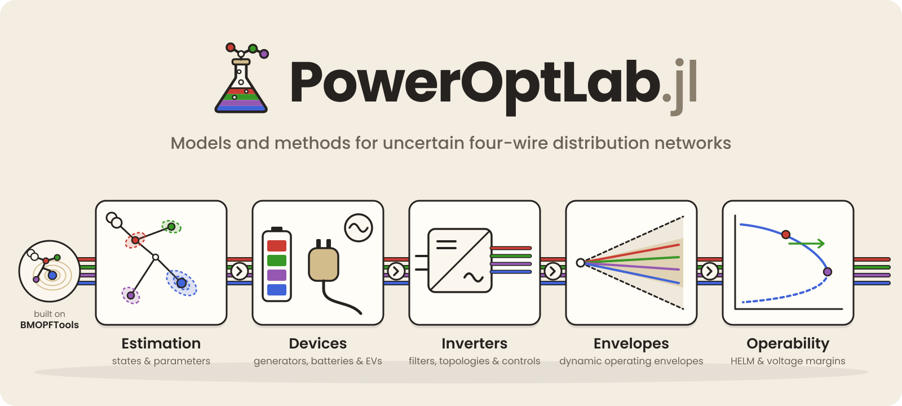

# PowerOptLab.jl

[](https://github.com/frederikgeth/PowerOptLab.jl/actions/workflows/CI.yml)
[](https://frederikgeth.github.io/PowerOptLab.jl/dev/)
[](LICENSE.md)

<p align="center">
  
</p>

PowerOptLab provides models and numerical methods for **four-wire distribution
networks with uncertain states and parameters**. It supports state and parameter
estimation, generator and inverter studies, battery and EV scheduling, dynamic
operating envelopes, and static voltage-operability checks.

The package builds on the
[BMOPFTools](https://github.com/frederikgeth/BMOPFTools.jl) current–voltage OPF
formulation, retaining explicit neutral conductors and per-unit scaling. The
[documentation](https://frederikgeth.github.io/PowerOptLab.jl/dev/) explains each
model's assumptions, validation and numerical limits.

> [!NOTE]
> This is research software under active development. APIs may change, and the
> validation scope differs between models and methods.

## Getting started

Use Julia **1.10 or later**. Clone the repository and install its pinned dependencies:

```sh
git clone https://github.com/frederikgeth/PowerOptLab.jl.git
cd PowerOptLab.jl
julia --project=. scripts/instantiate_pinned.jl
```

For an existing checkout, run the last command from its root. BMOPFTools is
unregistered; the setup script installs the tested commit declared in
[Project.toml](Project.toml) and checks agreement with
[docs/Project.toml](docs/Project.toml). It replaces a local BMOPFTools
`Pkg.develop` override. Manifests remain local and untracked.

Start with [Your first PowerOptLab study](docs/src/getting_started.md): a complete
230 V feeder and two-hour battery schedule, including network data, solver
status and physical checks. Its Julia blocks execute during the documentation
build.

## Study topics

| Study | Questions and methods | Start here |
|:--|:--|:--|
| State and parameter estimation | Estimate conductor voltages; calibrate selected line lengths and taps; retain overhead-line constructions consistent with sequence data. | [Estimation methods](docs/src/estimation/studies.md) |
| Device models and scheduling | Compare generator assumptions, select battery models, and schedule charging at fixed EV outlets. | [Device models](docs/src/components/index.md) |
| Inverter models and controls | Examine filters, converter topology, neutral current, DC-link stress and local control laws. | [Inverter studies](docs/src/ibr/index.md) |
| Dynamic operating envelopes | Allocate import/export capacity and test it over declared scenarios and participant utilisation points. | [DOE in 15 minutes](docs/src/tutorials/doe_getting_started.md) |
| Power flow and voltage operability | Compare nonlinear and HELM solutions; examine static voltage margins; reduce the neutral under declared grounding assumptions. | [Power-flow methods](docs/src/algorithms/index.md) |
| Numerical formulations and solvers | Compare smoothing, complementarity, exact PWL graphs and relaxations, with physical error budgets and solver diagnostics. | [Formulation studies](docs/src/formulations/index.md) |

The [API index](docs/src/api.md) locates topic references. The
[symbol index](docs/src/symbol_index.md) provides alphabetical lookup.

### Generators, battery storage and electric vehicles

| Family | Models | Guide |
|:--|:--|:--|
| Generators | `GeneralizedGenerator` and `SourceGenerator`: winding connections, internal voltage laws, source impedance, neutral grounding and operating limits. | [Generator models](docs/src/components/generators.md) |
| Battery storage | `StorageDevice` for AC power-energy scheduling; `IVQBattery` for cell current, voltage and charge under a supplied Rint model. | [Battery storage](docs/src/components/battery_storage.md) |
| Electric vehicles | `EV`, `EVSE` and `ChargingSession` for vehicles, AC outlet capability and fixed visits; `EVDevice` for compact compatibility studies. | [EV models and sessions](docs/src/ev/index.md) |

Battery efficiencies and limits require data appropriate to the study boundary.
The IVQ presets are illustrative, not calibrated cells. EV sessions use fixed
outlet assignments and availability; trip modelling and assignment optimisation
are outside the current model.

### Inverters and controls

`AdvancedInverter` represents the internal converter node, reduced-L or explicit
LCL filters, losses, current and apparent-power limits, and selected DC-link
stresses. Its three-phase alternatives are a three-leg three-wire bridge, a
four-leg four-wire bridge, and a three-leg four-wire split-capacitor bridge.

Switching limits use a sampled outer approximation of the continuous-time
switching hull; inspect the independent dense switching-margin audit and sampling
sensitivity near that boundary. Optional carrier-harmonic audits are local
calculations around a solved fundamental operating point. Steady-state
grid-forming constraints and these audits do not establish dynamic stability.
See [inverter models and controls](docs/src/ibr/index.md) for the equations,
phase-aware local laws, fleet studies and validation. A separate
[PV/tap bilevel proof of concept](docs/src/problems/bilevel.md) uses DiffOpt
sensitivities of a local lower-level response.

## Worked studies

Each of these includes complete inputs, expected results and executable checks:

- [Battery-model comparison](docs/src/tutorials/battery_storage_models.md): match
  PE and IVQ cycles, introduce resistance, and identify SoC-dependent export limits.
- [Four-wire state estimation](docs/src/tutorials/constrained_nlls_state_estimation.md):
  recover a displaced neutral, fit perturbed readings and remove measurements to
  examine observability and covariance.
- [Generator trade-offs under unbalance](docs/src/tutorials/generalized_generator_tradeoffs.md):
  compare voltage laws, winding connections and grounding on the same feeder.
- [Inverter topology under unbalance](docs/src/tutorials/ibr_topology_under_unbalance.md),
  [DC-source current sharing](docs/src/tutorials/ibr_dc_source_and_split_link.md)
  and [L/LCL carrier harmonics](docs/src/tutorials/ibr_ac_harmonics_lcl.md).
- [HELM versus nonlinear power flow](docs/src/tutorials/helm_vs_nonlinear_power_flow.md)
  and [post-OPF operability](docs/src/tutorials/post_opf_operability_study.md).
- [DOE allocation and verification](docs/src/tutorials/doe_getting_started.md),
  followed by [range guarantees](docs/src/tutorials/doe_range_guarantees.md) and
  [uncertainty studies](docs/src/tutorials/doe_uncertainty_coverage.md).

Run the published study and DOE code directly from the checkout:

```sh
julia --project=. scripts/run_study_tutorials.jl
julia --project=. scripts/run_doe_tutorials.jl
```

CI executes those pages on Julia 1.10 and current stable. The first-run,
generator and formulation examples execute through Documenter. The battery and
state-estimation figures are generated from solved data, with CI checks for
stale inputs and rendering code.

For larger inverter campaigns, see the
[Australian LV study](studies/australian_pv/README.md) and the earlier
[ENWL retrofit experiment](scripts/enwl_advanced_ibr/README.md). Their guides
state dataset requirements, conversion assumptions and provenance.

## Interpreting results and research scope

A successful local nonlinear solve does not establish global optimality.
Measurement fit, observability, covariance and physical validation are distinct
claims. For nonlinear AC envelopes, finite scenario/corner tests alone do not
certify a continuous uncertainty or utilisation set; sufficient static
certificates apply to their stated model
and region. See [Concepts](docs/src/concepts.md) for units, signs, status and
interpretation.

The longer-term research programme connects three questions: which states and
network models fit the evidence, which additional measurements would distinguish
them, and which operating decisions remain feasible under those alternatives.
Current APIs provide separate estimation, optimisation and checking methods.
Joint network-model identification and automatic experiment design remain
research objectives described in the [research programme](docs/src/research_program.md).

## Development and documentation

Run the package tests and build the documentation without deploying it:

```sh
julia --project=. -e 'using Pkg; Pkg.test()'
julia --project=docs scripts/instantiate_pinned.jl
DOCUMENTER_DEPLOY=false julia --project=docs docs/make.jl
```

Both package and documentation CI cover Julia 1.10 and current stable. For
intentional upstream development, use `Pkg.develop(path="../BMOPFTools.jl")`;
rerun the setup script to restore the tested revision before comparing with CI.
See [Contributing](docs/src/contributing.md) for extensions, documentation style,
figure regeneration and compatibility checks. Development workflow records live
in `dev/notes/`, outside the published documentation.

## License

Dual-licensed:

- **Source code:** [BSD-3-Clause](LICENSE.md).
- **Shipped data files:** [Creative Commons Attribution 4.0](LICENSE-DATA.md),
  including test cases, benchmark networks and datasets.
