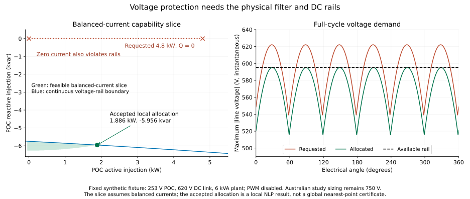

# Constraint-based inverter operation

[`ConstrainedInverter`](@ref) adds operating constraints to an
[`AdvancedInverter`](@ref). It is an alternative to the forward
[`SequenceController`](@ref), which retains its existing current limiters and
defaults. Start with [From current limits to operating rules](../tutorials/inverter_constraints_and_control.md)
for a worked P–Q explanation, then use this page as a formulation reference.
Choose according to the question being studied:

| Formulation | Selects the operating point through | When a current limit binds |
|:--|:--|:--|
| `ControlledDevice(plant, SequenceController(...))` | Prescribed current-command equations | The selected limiter backs off the command |
| `ConstrainedInverter(plant, VoltVarWattConstraints(...))` | An explicit dispatch objective, or a specified dispatch | The current inequality restricts feasible P while the Q equality remains |

The second formulation is an OPF feasible set. Maximising export over a network
does not establish that an autonomous local controller will select that point,
or that it will be dynamically stable. Neither option is a certification model.

## Select an operating mode

```julia
# Free Q, bounded active dispatch, PV source, balanced grid-arm current.
operating = InverterOperatingConstraints(p_min=0., p_max=4000.,
    q_min=-2000., q_max=2000.)
device = ConstrainedInverter(plant, operating;
    current_allocation=:balanced_grid, dc_source=DCSourceBounds(p_min=0.))

# Alternatives: FixedReactivePower(600.) or FixedPowerFactor(.95, :absorbing).
operating = InverterOperatingConstraints(reactive=FixedPowerFactor(.95, :absorbing))
```

Name the direction explicitly: `:absorbing` takes reactive power while
exporting, `:injecting` supplies it. The single-argument form stores the
signed value: for positive P, positive PF absorbs Q and negative PF supplies Q. The relation
is ``|pf|Q+sign(pf)\sqrt{1-pf^2}P=0`` for either direction of active power.
It imposes neither a direction nor a balanced-current assumption; PF at zero
complex power is undefined. Zero PF is rejected. Optional P/Q bounds compose
with any reactive mode. Use `VoltVarWattConstraints` for a voltage-dependent Q
equality; the general policy rejects a second, ambiguous Q law.

`DCSourceBounds(p_min=0)` permits loss imports at the AC port, while preventing
net DC charging. Signed bounds can model a bidirectional source. Omitted bounds
retain the previous availability-only behaviour. Source bounds are physical DC
power bounds, not bounds on POC active power or a battery energy model.

## Physical and operating relationships

For `VoltVarWattConstraints`, positive injection and the declared voltage curve
impose total POC reactive power

```math
Q_{POC}=q_{scale} f_{VV}(V),\qquad P_{DC}\le P_{available}.
```

The voltage input and reference come from the declared positive policy and
`sensing_reference`. For `sensing=:average_voltage`, the input is the arithmetic
mean of the three RMS phase magnitudes. Curve encodings use the same smooth,
flat-extended PWL functions as the existing controller. A missing Q curve imposes
zero total POC Q in `VoltVarWattConstraints`. A missing watt curve gives a fraction
of one in that policy, **and the ceiling is still imposed**: with the rated basis
it caps P at ``P_{rated}``, as the forward controller's
``\min(P_{rated}f_{VW},P_{available})`` command does. The general
`InverterOperatingConstraints` policy leaves Q free by default and adds **no**
watt ceiling when its watt curve is absent; add `p_max` for a rated cap. The same
positive-sequence policy object therefore yields different ceilings in the two
wrappers, by design.

For `volt_watt_basis=:rated`,

```math
P_{POC}\le P_{rated} f_{VW}(V).
```

For `:available`, define the solved AC availability
``A=P_{upper}-(P_{DC}-P_{POC})``, where ``P_{upper}`` is the tighter of request
availability and an optional DC source upper bound, and impose
``P_{POC}\le f_{VW}(V) A``. Together with the independent DC bound this is
equivalent to ``P_{POC}\le\min(A,f_{VW}A)``. When ``A<0``, the full loss import
is retained. DC availability is not incorrectly treated as lossless AC output.

``A`` uses the **solved** losses, so the ceiling depends on the operating point:
more reactive current raises filter and conduction losses and lowers it.
Firmware that scales a separately measured or estimated available power can
differ by those losses, and the product ``f_{VW}(V)\,(P_{DC}-P_{POC})`` adds a
nonconvex term to the model.

The plant retains all declared per-conductor RMS current, capacitor and ripple
limits, along with switching-voltage feasibility. `power_limit_location` selects
its apparent-power circle: `:converter` by default or `:poc` for total PCC
exchange, including the PCC shunt. Phase, neutral and capacitor current ratings
may be omitted independently; their physical equations remain active. There is no radial P/Q
allocation, common current scale, or automatic Q slack. An impossible reactive
request gives an unsuccessful solve. Physical limits are not relaxed to make a
voltage curve feasible.

This path normalises capability rows and operating power rows by the
device rating. This keeps the solver's constraint-bound relaxation small in
physical units when a small inverter is embedded in a large network power base.
Forward-controller stamping also normalises engineering capability rows.

The wrapper supports three-phase THREE_LEG, FOUR_LEG and SPLIT_DC plants with
`grid_forming=false`. The default `:balanced_converter` imposes zero and negative
sequence converter current (without duplicating the three-leg zero-sum row).
`:balanced_grid` imposes balance on the grid arm; `:free` leaves current allocation
to the optimiser within topology and capability bounds. Balanced grid current
and three-leg converter zero sum can be incompatible with a grounded LCL shunt
under zero-sequence voltage: infeasibility is a valid physical result.
Q tracking includes the filter and optional POC
shunt through the plant's total POC exchange. `pwm_strategy=:NONE` is required;
fixed calibrated RMS current reserves are supported, but automatic carrier
reserve iteration is not part of this solve.

## Offline voltage-aware current allocation

[`project_inverter_current`](@ref) supplies an offline allocation reference at a
fixed terminal voltage. It minimizes the sum of squared complex-current errors
while retaining the physical plant, source bounds and full-cycle rail checks.
The requested converter-arm or grid-arm current is independently reconstructed
through the filter and audited before solving for an alternative.

```julia
allocation = project_inverter_current(plant, request;
    grid_voltage=poc_rms_phasors, requested_current=command_rms_phasors,
    target=:converter, dc_source=DCSourceBounds(p_min=0.))
allocation.request_feasibility  # :feasible, :violated or :unresolved
allocation.plant_feasibility    # :feasible or :unresolved
solve_status(allocation)        # status of the local allocation solve
```

A violated request and an accepted alternative distinguish a command outside
capability from an impossible operating boundary. An unsuccessful NLP establishes
neither plant infeasibility nor controller-policy infeasibility. If the direct
request audit passes, that point itself establishes conditional plant feasibility
even if the allocation solver fails. A singular converter-to-grid filter transfer
leaves the direct request audit unresolved; it is not labelled infeasible.
The allocated point's report also independently verifies that the fixed voltage
and balancing charge match the requested boundary in SI units.
For continuous rails, a negative conservative lower enclosure alone also does not
prove a violation: the direct diagnostic requires a violating sampled witness.

Voltage feasibility can require changing the direction of current, rather than
scaling it toward zero. For example, a synthetic balanced 253 V boundary with a
620 V DC link rejects a 4.8 kW unity-PF command but admits a point near
1.886 kW / -5.956 kvar on the same 6 kVA plant. These values are a regression
fixture, not changes to the Australian study's 750 V hardware.
Reproduce this case, a feasible nominal request and energized zero-PV operation
with the same fixed plant:

```sh
julia --project=. scripts/formulations/inverter_current_projection.jl /tmp/current_projection.json
```

The optional JSON artifact records hardware, solver settings, source fingerprints,
requested-point failures and the allocated point's individual physical checks.



The left panel restricts the capability slice to balanced currents; it is not a
projection of the full sequence-current feasible set. The right panel uses the
saved requested and allocated phasors to show their instantaneous line-voltage
envelopes. Regenerate with `scripts/formulations/plot_current_projection.py`.

The reference uses a local nonconvex solve; it does not certify a globally nearest
point or implement reactive-priority VV+VW. Voltage is fixed, so there is no
feeder feedback or dynamic stability claim. For split links, the explicit
`midpoint_charge` (default zero) is fixed in both the request audit and the solve;
these results are conditional on that actuator state. PWM is disabled. The local
priority-aware reference below adds measured-voltage allocation; feeder feedback,
optimized balancing charge and EMT remain separate work.

## Local voltage-aware reactive priority

[`allocate_inverter_services`](@ref) selects a command through staged physical
solves at a fixed measured POC voltage:

1. Track total POC Q as closely as locally feasible.
2. Hold that achieved reactive service and maximize POC active export.
3. Hold both powers and allocate requested negative-sequence current along its
   declared complex ray on the selected converter or grid arm.

The stages share the full filter, source, current, power, thermal and modulation
model. Each stage must pass its own SI audit before the next runs. Fixed voltage,
sequence-command, preserved-power and volt-watt conditions receive independent
checks. The available-power ceiling uses a conservative enclosure of recomputed
DC power. A failed stage retains its diagnostics and issues no command.

```julia
r = allocate_inverter_services(plant, request;
    grid_voltage=poc_rms_phasors, reactive_request=-2600.,
    active_fraction=1., volt_watt_basis=:rated, target=:converter)
r.current_command              # nothing unless every stage publishes
r.stages                       # all stage results, including failures
r.plant_feasibility            # :feasible or :unresolved
r.policy_feasibility           # :feasible or :unresolved
```

Default `reactive_mode=:within_request` permits Q between zero and the requested
value. Explicit `:protective_override` permits a different Q when protection
requires it, while minimizing tracking error before considering P. This changes
the controller policy. It is never a fallback hidden inside a failed strict
solve. An optional unrestricted physical projection can demonstrate feasible
plant operation after a failed first stage, but it is returned only as a diagnostic.
Local solver failure establishes no global infeasibility of either feasible set.

Within the requested Q ray, the model maximizes a bounded service coordinate and
then fixes that coordinate. Adding a nearly coincident Q equality to the active
Q interval produced a spurious `LOCALLY_INFEASIBLE` P stage for the Australian
worst-phase request; fixing the service coordinate preserves Q without that
redundancy. No per-case solver retry is used. In protective-override mode, the
tracking epigraph is removed after fixing achieved Q, leaving no unused tracking
variable in the P objective.

[`evaluate_voltage_aware`](@ref) evaluates the exact mean, worst-phase or
positive-sequence VV+VW laws and calls this allocator. Supply sensed phasors as
`InverterControlMeasurement` and the physical `grid_voltage` separately. The
adapter requires reactive priority and Q→P→I₂ sequence order. Voltage-admittance
droop is supported; current-dependent ripple blending is explicitly rejected.
All three-leg hard limits remain active. More I₂ can increase losses, so strict
P-before-I₂ ordering may leave little support when DC availability binds.

These are solver-based local control references. They change allocation relative
to the algebraic limiters and do not replace the fixed-structure controller stamp.
Nonconvex local solutions do not prove globally best service allocation. Solver
latency, dynamic stability and response times require separate validation.
The voltage-aware fleet solver couples the local references to feeder equations;
its independent closure checks are described in the verification guide.

Reproduce seven fixed-boundary examples with the unchanged Australian hardware
and the separately declared synthetic rail fixture:

```sh
julia --project=. scripts/formulations/inverter_service_allocation.jl /tmp/service_allocation.json
```

The saved `scripts/formulations/inverter_service_allocation_reference.json`
records per-stage checks and source fingerprints. Six cases issue accepted
commands; the strict synthetic Q-ray case remains unresolved while its independent
diagnostic finds feasible plant operation. The local Australian comparisons are
fixed-measurement tests, not new feeder or chronological results.

## Four-leg phase control

[`PerPhaseVoltVarWatt`](@ref) uses each sensed phase-neutral RMS voltage to
evaluate its exact VV and VW curves. Each phase's Q base and rated P base are
one third of the total request bases. It requires an explicit neutral,
`topology=:FOUR_LEG`, a non-GFM plant and disabled PWM. Use
`evaluate_voltage_aware` at fixed physical phasors or
`solve_voltage_aware_inverter_fleet` for network feedback. The implicit
`solve_controlled_inverter` path does not implement this policy.

The allocation first maximizes one common fraction of the three requested
reactive powers, then fixes that fraction and maximizes total active power.
POC phase active powers are equal; phase currents generally are not balanced.
Consequently the most restrictive phase VW ceiling also constrains the other
phases' active export. With `volt_watt_basis=:available`, each phase uses one
third of the shared AC availability after total solved losses. There are no
independent phase PV sources or inferred phase VA ratings. The total VA bound
does not by itself bound large opposing phase reactive powers; declare phase
and neutral current ratings when these engineering bounds are required.

```julia
policy = PerPhaseVoltVarWatt(volt_var=vv, volt_watt=vw,
    volt_watt_basis=:rated, current_target=:converter)
controlled = ControlledDevice(four_leg_plant, policy)
allocation = evaluate_voltage_aware(controlled,
    InverterControlMeasurement(sensed_phase_neutral), request;
    grid_voltage=physical_phase_neutral)
```

`allocate_phase_inverter_services` exposes the same allocation with explicit
three-element Q requests and VW fractions. Only `reactive_mode=:within_request`
is supported. Hardware, source, continuous rails and phase-policy checks gate
every stage; a failed stage returns no command. Optional unrestricted projection
is a separate physical witness and never substitutes another policy. Neutral
ratings are RMS bounds, not peak switching-current ratings. Neither this
quasi-static reference nor its per-phase curves establish connection-standard
conformity, dynamic stability or an EMT-validated controller.

## Embedded PWM thermal allocation

Set `pwm_strategy=:CENTERED` and `f_sw` on a monolithic three/four-leg plant to
include switching-current stress inside the constrained dispatch and Q→P→I₂
allocation stages. The phase/DC ratings are unchanged. An open carrier-frequency
DC source is required; automatic AC-current reserve closure, finite carrier
source branches and split-link PWM allocation are explicitly rejected here.
The existing standalone inverter reserve-loop solver retains its separate scope.

The formulation integrates the ideal shared-carrier second moment analytically
for fundamental current/voltage phasors. It bounds the DC voltage denominator
over the whole cycle and encloses the voltage-norm smoothing error. This is a
dispatch-dependent expression, not a factor calibrated at another point.
Independent numerical integration of exact carrier dwell probabilities checks
actual frozen-current RMS and modulation feasibility after each solve.

`ConstrainedInverter(...; pwm_thermal_headroom=0.05)` reserves an additional
validation allowance on the switching component. This allowance does not prove
a universal bound on AC switching ripple or semiconductor dynamics. The local
allocators and voltage-aware fleet use the same default. Representative EMT at
the declared filter, switching frequency and source assumptions is still required.
Capacitor ESR weights, any independent `i_sw`, and calibrated AC RMS reserves
continue to compose with the new term.

At a maximum-Q thermal boundary, an exact Q lock can make the P-stage feasible
set tangent and singular. PWM stages therefore preserve higher-priority service
within a declared **0.0001 var/W SI budget**. Hardware limits and physical
acceptance tolerances are unchanged; raw `ALMOST_LOCALLY_SOLVED` points remain
unpublishable. This is bounded numerical lexicographic preservation, not a
weighted objective or a hidden protective-Q override.

## Nonlinear capacitor energy

Set `dc_energy_model=:nonlinear` on a monolithic three/four-leg plant to keep
the specified mean DC voltage while bounding the actual nonlinear capacitor
waveform. `dv2_max` still means the peak Fourier 2ω voltage coefficient.
Optional `v_dc_min` and `v_dc_max` independently bound voltage extrema. Total
low-frequency capacitor current includes the waveform's higher even harmonics;
the declared low-frequency ESR weight applies to this group.

The nonlinear option composes with embedded centered PWM in constrained models
and voltage-aware allocation. It assumes constant input power and a fixed mean
loss. Finite small-signal source branches and split links are rejected. Implicit
forward-controller backoff and standalone PWM reserve closure retain their
linearized scope; use the voltage-aware allocator for the nonlinear option.
Both PWM and nonlinear-energy stages use the explicit 100 µvar/W service
preservation budget. See the energy equations in the foundations chapter and
[`dc_link_energy_diagnostics`](@ref) for independently reconstructed quantities.

## [Compare saturation at a fixed 207 V POC](@id inverter-saturation-comparison)

This ideal, lossless example fixes POC voltage to isolate capability allocation
from network feedback. Zero filter impedance is a deliberate idealisation.

```@example constrained_inverter
using PowerOptLab
using BMOPFTools: parse_bmopf

net = parse_bmopf("""
{"bus":{"poc":{"terminal_names":["a","b","c","n"],
 "perfectly_grounded_terminals":["n"],"v_min":[180,180,180],"v_max":[280,280,280]}},
 "voltage_source":{"vs":{"bus":"poc","terminal_map":["a","b","c"],
 "v_magnitude":[207,207,207],
 "v_angle":[0,-2.0943951023931953,2.0943951023931953]}}}
"""; from_string=true)

plant = AdvancedInverter(id="pv", bus="poc", topology=:THREE_LEG,
    phase_terminals=["a","b","c"], neutral=nothing,
    s_max=6000., i_max=1.1*6000/(3*230),
    v_dc=800., c_dc=2e-3, r_filter=0., x_filter=0.)
intent = VoltVarWattIntent(
    volt_var=PWLFunction([207.,220.,240.,258.], [.44,0.,0.,-.60]),
    volt_watt=PWLFunction([253.,260.], [1.,.2]),
    sensing=:average_voltage, volt_watt_basis=:rated)
encoding = VoltVarWattEncoding(
    volt_var=LocalC2Formulation(.01), volt_watt=LocalC2Formulation(.01))
request = InverterControlRequest(p_available=6000., p_rated=6000., q_scale=6000.)

policy = VoltVarWattConstraints(intent, encoding)
device = ConstrainedInverter(plant, policy)
constrained = solve_constrained_inverter(net, device, request;
    objective=:max_export, solver_options=("tol" => 1e-9,))
forward = solve_controlled_inverter(net,
    ControlledDevice(plant, SequenceController(lower_positive_policy(intent, encoding);
        limiter=CommonScaleLimiter(pq_priority=:var))), request;
    solver_options=("tol" => 1e-9,))
@assert constrained.solve.publishable && forward.solve.publishable
@assert abs(constrained.operation.q_constraint_residual_var) < .05

[(model="forward controller", P_W=forward.plant.p_poc, Q_var=forward.plant.q_poc),
 (model="operating constraints", P_W=constrained.plant.p_poc, Q_var=constrained.plant.q_poc)]
```

Ignoring the small curve-smoothing effect at the endpoint, the forward model
delivers approximately 5334 W and 2614 var. The constrained model delivers
approximately 5321 W and 2640 var. In this balanced idealisation,
``S_{effective}=\min(S_{rated},3VI_{max})=5940`` VA, so the independent
capability oracle is ``P=\sqrt{5940^2-2640^2}``. The constrained model curtails
about 13 W more active power and retains the requested reactive power.

## Fixed dispatch and composition

```@example constrained_inverter
fixed = solve_constrained_inverter(net, device, request;
    objective=:feasibility, p_set=4000., solver_options=("tol" => 1e-9,))
@assert fixed.solve.publishable
(P_W=fixed.plant.p_poc, Q_var=fixed.plant.q_poc)
```

For an external OPF, call `stamp_device!(ctx, device; request)` inside the model
hook. The returned handles expose physical plant quantities through
`inverter_handles(device, handles)`. The stamp adds no objective, so the caller
can select cost, export, a fixed dispatch, or another criterion. Use
`extract_device(device, handles, solve_status)` after solving. For a fleet,
stamp each device in the shared model; a sum-of-export objective represents
coordinated fleet optimisation. The existing `ControlledInverterFleetSpec`
continues to describe the forward-controller formulation.

For a complete multi-device example, see [full network OPF and independent
validation](../ibr/full_network_opf.md). It includes three inverters, floating
neutrals, mutual line coupling, native and hook voltage-bound formulations,
binding network limits and a separate four-wire power-flow replay. The public
`solve_status(model)` overload supplies the extraction status for composed models.

## Read the diagnostics

`result.plant` reports physical SI quantities. `result.operation` reports:

- `q_target_var` and `q_constraint_residual_var`: the encoded curve equality;
- `q_exact_target_var` and `q_tracking_residual_var`: the exact PWL policy at the
  solved voltage, separating curve approximation from electrical feasibility;
- `volt_watt_margin_W` and `exact_volt_watt_margin_W`: encoded and exact cap slack;
- `dc_availability_margin_W` and `ac_available_W`: the physical power budget;
- current, selected-location apparent-power, switching-voltage and DC ripple margins.

`power_limit_location`, `apparent_power_rating_VA` and `apparent_power_margin_VA`
identify the enforced circle. `converter_apparent_power_margin_VA` and
`poc_apparent_power_margin_VA` are `nothing` at the inactive location.

General policies also report `reactive_mode`, `current_allocation`, source
bounds and source/P/Q margins. Fixed PF has `fixed_pf_residual_VA`; free Q and PF
have `nothing` for Q targets and tracking residuals. A missing watt ceiling in
`InverterOperatingConstraints` similarly returns `nothing` for cap margins.
Four-leg/split-link results include neutral RMS, midpoint and capacitor margins.

Margins are positive inside their limits. Undeclared optional limits return
`nothing`. Failed solves retain `SolveStatus` and return NaN numerical outputs.
There are no invented limiter scales or exact-current replay fields for this
feasible-set formulation. As with the other nonlinear solvers, a successful
solve provides a local solution and does not prove global optimality or global
infeasibility.

## Reproduce forward operation through optimisation

The executable [reproduction cases](../ibr/formulation_reproductions.md) compare
independently solved feeder equilibria, saturated proportional limiting and
sequence-priority allocation. They distinguish agreement under matched
assumptions from the intentional saturation difference above.

## Simulation and optimisation formulations

Here, **simulation** means the algebraic forward controller at a fundamental-frequency
network equilibrium. It does not mean time-domain or switched EMT simulation.
The physical plant is shared; operating relationships and the selection objective
determine which feasible point is selected.

| Concept | Forward simulation (`SequenceController`) | Optimisation (`ConstrainedInverter`) | Support / equivalence condition |
|:--|:--|:--|:--|
| Network, reduced filter, primitive matrices, LCL, POC shunt | Plant KCL/KVL and prescribed current | Same plant KCL/KVL and dispatchable current | Implemented; compare powers at the same location |
| Three-leg zero sum | Plant requires converter `I0=0` | Same topology equality, including `:free` allocation | Implemented; topology does not require `I2=0` |
| Current allocation | Positive/negative sequence commands at converter or grid target | `:balanced_converter`, `:balanced_grid`, or `:free` | Implemented; LCL capacitor current makes the two balance choices distinct |
| Volt-var | Curve produces a Q command before limiting | `VoltVarWattConstraints` imposes total POC Q equality | Implemented; saturation can intentionally produce different Q |
| No reactive curve | Zero Q command | `VoltVarWattConstraints`: Q=0; `InverterOperatingConstraints`: Q free | Explicitly different defaults |
| Fixed Q / signed PF / free Q | No dedicated fixed-PF policy; a constant curve can prescribe Q | `FixedReactivePower`, `FixedPowerFactor`, `FreeReactivePower` | Implemented on total POC powers; PF does not select current sequences |
| Volt-watt | Active command, rated or AC-available basis | Upper bound on POC P with the same curve/basis | Implemented; maximum export can reproduce an unsaturated command |
| P/Q dispatch bounds | Request and controller prescribe operation | Optional `p_min`, `p_max`, `q_min`, `q_max` | Implemented; inconsistent bounds and service remain infeasible |
| DC source availability and charging | Request availability with loss-aware command | Request upper bound plus signed `DCSourceBounds` | Implemented; `p_min=0` declares non-charging PV; default has no lower bound |
| Converter/grid conductor current and neutral RMS | Command backoff plus hard plant inequalities | Hard plant inequalities | Implemented, including fixed switching RMS reserves |
| Apparent power | P/Q command allocation and plant-aware backoff at the selected boundary | Hard S circle at `power_limit_location` | Converter default; `:poc` includes the whole filter and PCC shunt |
| Proportional current limiter | Scales both current sequences / P and Q together | No implicit limiter; optional explicit current-ray restriction plus maximise scale | Reproduction example provided; the ray is an extra operating assumption |
| Sequence priority | Reserve one sequence, fill headroom with the other | Fix admissible reserved sequence and maximise other-sequence scale | Fixed-measurement reproduction provided; arbitrary network-equilibrium equivalence is not established |
| Negative-sequence admittance / ripple cancellation | Prescribed negative-sequence current law | `:free` exposes sequence choices; physical sequence/ripple caps still apply | Law-specific optimal objectives or exact command graphs remain future work |
| Internal voltage and switching utilisation | Same sampled switching hull and voltage boxes | Same hard bounds | Implemented; sampled hull is an outer approximation, audit `switching_margin` |
| DC 2ω ripple and finite line-frequency source | Plant ripple circuit and backoff | Same hard circuit/capability constraints | Implemented; source impedance here differs from signed DC power bounds |
| Four-leg / split-link neutral, midpoint, capacitor heating, ESR | Physical plant; controller wrapper remains three-leg | THREE_LEG, FOUR_LEG, SPLIT_DC plants; common/individual bank bounds compose | Implemented for three-phase optimisation; split midpoint balancing remains bounded by configured charge authority |
| Semiconductor and capacitor losses | Same physical loss equations | Same physical loss equations under either power direction | Implemented; no objective-dependent inflatable loss epigraph |
| Carrier PWM reserve closure | Plant solver has post-solve carrier iteration/audits | Fixed reserves supported; wrapper requires `pwm_strategy=:NONE` | Automatic optimisation closure remains future work |
| Single phase / grid forming | Plant supports legacy single phase and fixed balanced internal EMF; not `SequenceController` | Wrapper rejects both | Dedicated operating laws remain future work; no GFM droop or dynamic-stability claim |
| Curve encoding | Smooth local/global encodings and separate exact numeric evaluator | Same smooth voltage encodings, exact residual audit | Exact PWL graphs in complete inverter models remain future work |
| Objective / fleet / time coupling | Objective should not change prescribed operation; forward fleet/study APIs exist | Caller chooses objective and can stamp devices in a shared model | Composition implemented; dedicated constrained-fleet/DOE/time APIs remain future work |
| Hardware sizing / variable DC rail | Existing controller parameter/sizing studies | Fixed physical hardware in this wrapper | Continuous design variables and DC energy/rail dynamics remain future work |
