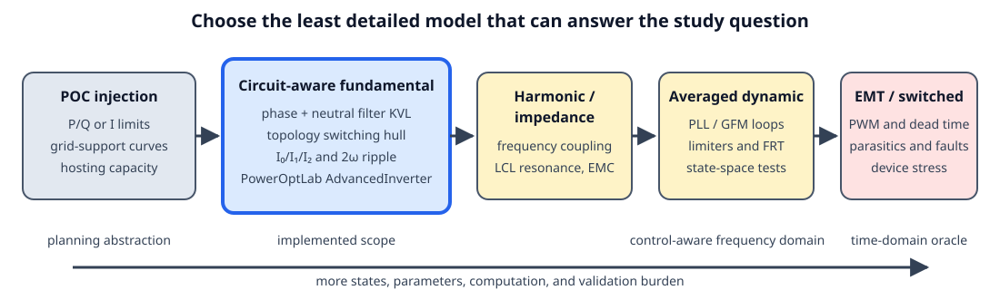
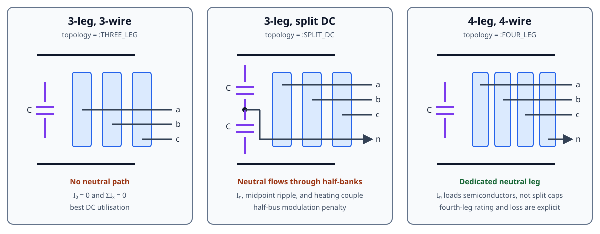

# Inverter-based resources

PowerOptLab provides two inverter models:

- a **POC injection model** for studies specified by active/reactive-power or current commands; and
- [`AdvancedInverter`](@ref), a **circuit-aware fundamental-frequency model** for
  studies in which the internal converter voltage, output filter, bridge
  topology, neutral path, or DC-link stress changes the feasible operating set.

Use the point-of-connection model for studies described by terminal power and
current limits. Use the circuit model when the filter, converter topology or
DC link affects the feasible operating region.

## Models and worked studies

Use the [advanced inverter modelling guide](../components/advanced_inverter.md)
and [tutorial](../tutorials/advanced_inverter_modelling.md) to choose a plant.
The [advanced inverter API](../api/advanced_inverter.md) lists its constructor,
solve entry point and results. For local laws, use the
[control modelling guide](../components/inverter_controls.md) and
[phase-aware control API](../api/inverter_controls.md).

[Fleet and hardware studies](network_control_studies.md) and
[closed-loop evidence diagnostics](closed_loop_evidence.md) document their
network-level interfaces. The [learning tutorial](../tutorials/learning_smart_inverter_controls.md)
examines policy fitting and replay; the
[bilevel PV/tap guide](../problems/bilevel.md) and
[API](../api/bilevel.md) cover a separate hierarchical-control proof of concept.

## Represented phenomena

`AdvancedInverter` represents RMS fundamental phasors and derives selected
line-frequency DC quantities from them. It includes:

- an internal converter node behind either a reduced conductor-domain series
  primitive or an explicit LCL network with two primitive arms, a damped
  midpoint capacitor, distinct arm currents, and an optional POC shunt;
- converter-side apparent-power and conductor-current limits;
- 3-leg 3-wire, 3-leg split-DC 4-wire, and 4-leg 4-wire switching-feasibility
  regions;
- Fortescue zero-, positive-, and negative-sequence current limits;
- neutral current, unequal split-link half-bank capacitance, fundamental and
  mean midpoint displacement, bounded balancing charge, 2ω power pulsation,
  DC-bus voltage ripple, and simultaneous frequency-weighted capacitor budgets;
- an optional ideal shared-carrier PWM audit with SPWM or centered continuous
  PWM, switching-current/voltage-ripple diagnostics, optional finite DC-source
  R–L current sharing, split-rail voltage stress, antiresonance screening, and
  conservative operating-point-dependent capacitor-reserve closure;
- an optional carrier-harmonic AC audit through reduced-L or primitive LCL
  networks, including phase/neutral mutual coupling, damping, path-resolved
  ripple, and total-RMS current-limit closure;
- fixed, current-linear, and current-quadratic converter loss terms, including
  the neutral semiconductor leg for a 4-leg bridge, plus optional weighted
  capacitor-ESR dissipation; and
- a bounded balanced internal voltage for steady-state grid-forming studies.

The available topologies are:

| `topology` | AC conductors | Neutral return | DC structure | Distinct limiting mechanism |
| --- | ---: | --- | --- | --- |
| `:THREE_LEG` | 3 | none; `ΣIₓ = 0` | monolithic link | line-to-line switching hull |
| `:SPLIT_DC` | 4 | capacitor midpoint | two possibly unequal half-banks in series | half-bus utilisation, mean/fundamental midpoint motion, individual-bank heating |
| `:FOUR_LEG` | 4 | fourth semiconductor leg | monolithic link | fourth-leg current and loss |

The split-DC model is a **three-leg bridge with a split capacitor link**. It is
not the reconfigurable four-leg-plus-split-link hybrid studied by Deakin,
Heidari, and Deng. That hybrid is a useful future topology, but it should not be
silently folded into either existing category.

## Read this chapter in layers

1. [Scientific foundations](@ref ibr-scientific-foundations) derives the model
   from conductor KVL/KCL, complex power, symmetrical components, capacitor
   energy, and the ideal switching hull.
2. [Phase-aware local control laws](@ref ibr-phase-aware-control-laws) derives
   and classifies topology-compatible Volt-var/Volt-watt extensions for
   unbalanced voltages.
3. [Phase-aware control modelling guide](@ref inverter-control-api) constructs and
   solves the implemented three-leg laws with executable examples.
4. [Inverter-control study methodology](@ref ibr-control-study-methodology)
   describes the model implementation, validation tests and hardware-sizing
   experiments used in network studies.
5. [Verification and benchmark cases](@ref ibr-verification) maps claims to unit,
   regression, paper, and higher-fidelity tests.
6. [IBR references](@ref ibr-references) is the maintained bibliography and
   literature roadmap.
7. The [advanced inverter component reference](@ref AdvancedInverter) documents
   the current API and equations; the [modelling tutorial](@ref
   advanced-inverter-modelling) shows how to choose and parameterise it.

## Reproducible study tutorials

The focused tutorials turn the equations into comparative engineering studies:

- [Choosing an IBR topology under unbalance](@ref
  ibr-topology-under-unbalance) compares 3-leg, 4-leg, and split-DC capability
  on identical balanced and sequence-rich grids.
- [DC-source impedance and split-link carrier stress](@ref
  ibr-dc-source-and-split-link) demonstrates harmonic current sharing,
  source loss, spectral convergence, antiresonance screening, and unequal rail
  voltage ripple.
- [Carrier harmonics through L and LCL filters](@ref ibr-ac-harmonics-lcl)
  separates converter, grid, midpoint-capacitor, and neutral ripple and tests the
  reduced-filter limiting case.

Each starts from a complete BMOPF network and includes publication checks. The
general modelling tutorial remains the best entry point for choosing the correct
abstraction; these three are designed to be run as research-study templates.

## What this model must not be used to claim

This is not a harmonic power flow, sequence-impedance scan, averaged control
model, or switched EMT model. In particular, `grid_forming=true` is a
steady-state internal-voltage constraint, not evidence of synchronization,
fault ride-through, black start, stable current limiting, or multi-inverter
power sharing. `i_sw` is still a manually reserved RMS allowance; the separate
carrier audit is an ideal PWM reconstruction around a frozen fundamental
operating point, not a switched network solution.

Those boundaries are intentional. Moving to the right on the fidelity ladder
requires controller transfer functions, detailed filter parasitics,
semiconductor and capacitor frequency/temperature data, and a different
validation oracle. The chapter records those next layers without pretending
they are already implemented.

## Figures and derivation sources

Fourteen diagrams now cover abstraction level, physical topology, conductor KVL,
the explicit LCL midpoint, sequence-to-hardware pathways, a published 2ω
waveform case, the balanced voltage-utilisation boundary, and asymmetric
split-link charge/current pathways, the carrier-PWM audit and reserve feedback,
DC-source/capacitor harmonic current sharing, carrier harmonics through the LCL
network, and the phase-aware control signal chain, curve envelopes, and ripple
disk. The last ten are generated by
`docs/scripts/generate_ibr_figures.jl` so numerical labels cannot drift from the
derivation.
