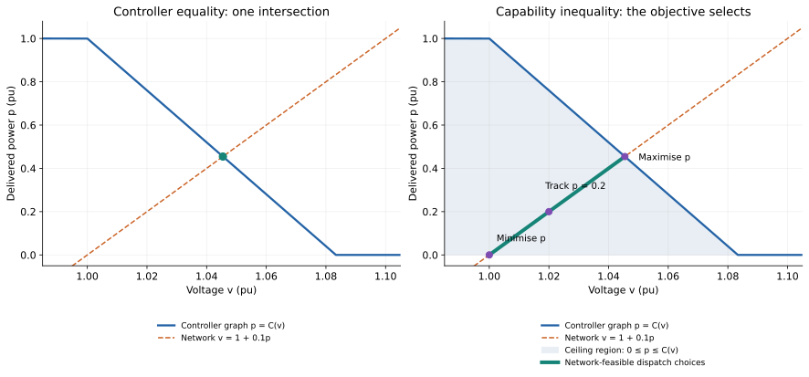
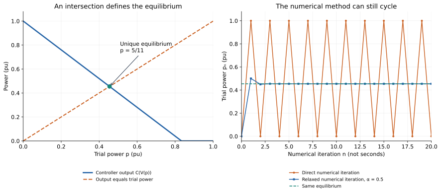
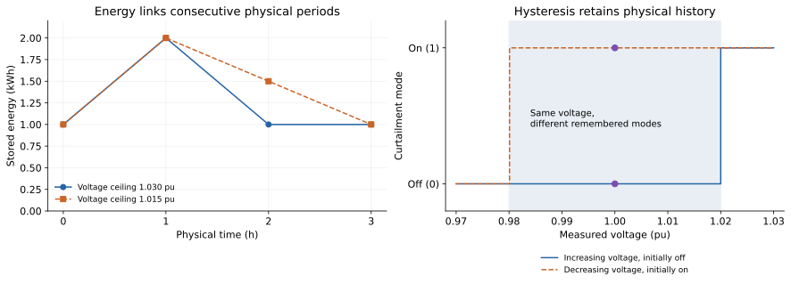

# From a controller program to an equilibrium problem

This workbook is for readers who naturally think **read inputs → execute logic
→ update outputs → advance time**. We will translate one small controller into
simultaneous equations, then change its operating freedom deliberately.

Some simulators already solve simultaneous algebraic systems internally. This
workbook makes those relationships visible and separates a prescribed
controller from dispatch choices that an objective may select.

Keep three indices separate throughout:

| Index | Meaning | What advances it? |
|:--|:--|:--|
| ``n`` | A numerical attempt to find a solution | The solution algorithm |
| ``t`` | A physical time period or sample | The physical model's clock |
| No index | An operating point satisfying simultaneous relationships | Nothing advances; we solve for consistency |

Work through **predict → run → explain** in each exercise. All Julia helpers
are in `scripts/formulations/equilibrium_workbook.jl`; they are teaching utilities,
not package APIs. Run the whole workbook with
`julia --project=. scripts/formulations/equilibrium_workbook.jl`.
The toy voltage equation below illustrates feedback; it is not a calibrated
AC power-flow or inverter dynamics model. The
[inverter P–Q tutorial](inverter_constraints_and_control.md) and
[network reproductions](../ibr/formulation_reproductions.md) supply the
circuit-aware follow-up.

## Exercise 1: find the feedback hidden in the program

Let delivered active power be ``p`` and measured voltage be ``v``, both in
normalised units. A source has one unit of available power. The toy network and
voltage-watt controller are

```math
v=1+0.1p,\qquad C(v)=\operatorname{clip}(1-12(v-1),0,1).
```

More export raises voltage. The controller reduces its command as voltage
rises. A programmer might search for a consistent operating point like this:

```julia
p = 0.0
for n in 1:20
    v = 1 + 0.1p                  # network response to the present trial
    raw = 1 - 12(v - 1)           # controller calculation
    command = clamp(raw, 0, 1)    # controller's clipping rule
    p = command                  # next numerical trial
end
```

**Predict:** write down the first three trial powers. Will the program settle?

```@example equilibrium_lesson
using PowerOptLab
include(joinpath(pkgdir(PowerOptLab), "scripts", "formulations", "equilibrium_workbook.jl"))
parameters = wb_parameters()
direct = wb_iteration(parameters; steps=20)
@assert direct.power[1:4] == [0.,1.,0.,1.]
direct.power[1:8]
```

The trial cycles between 0 and 1. At ``p=0``, voltage is 1 and the command is 1.
At ``p=1``, voltage is 1.1 and clipping makes the next command 0. This numerical
procedure has not found a consistent operating point.

Now translate each line by its mathematical role:

| Program statement | Relationship or role | What must be retained? |
|:--|:--|:--|
| `v = 1 + 0.1p` | Network equation | Voltage and delivered power must agree |
| `raw = 1 - 12(v - 1)` | Controller calculation | The same solved voltage enters the law |
| `command = clamp(raw, 0, 1)` | Operating relationship | Clipping values **and branch conditions** |
| `p = command` | Controller equilibrium condition | Delivered power equals the command at that voltage |
| `for n ...` | Numerical solution method in this example | It need not become a physical time axis |
| Available power = 1 | Source capability | ``0\le p\le1`` still applies |

An assignment computes an output from the program's present inputs. An
equilibrium equality constrains the inputs and outputs together. The two
interpretations meet at a fixed point of the program's feedback loop.

## Exercise 2: solve the operating point without following the loop

On the controller's sloping branch, substitute the network equation:

```math
p=1-12(v-1),\quad v=1+0.1p
\quad\Longrightarrow\quad 2.2p=1.
```

So ``p^*=5/11\approx0.4545`` and ``v^*=23/22\approx1.04545``. The raw command
is between 0 and 1, which confirms that this branch assumption is consistent.

**Predict:** will a simultaneous model need a maximum-export objective to find
this point?

```@example equilibrium_lesson
using JuMP, Ipopt
model = Model(Ipopt.Optimizer)
set_silent(model)
set_optimizer_attribute(model, "tol", 1e-10)
@variable(model, 0 <= p <= 1)
@variable(model, v)
@constraint(model, v == 1 + 0.1p)
@constraint(model, p == 1 - 12(v - 1))  # sloping branch, checked below
@objective(model, Min, 0.0)
optimize!(model)
@assert _wb_solved(model)
@assert abs(value(p)-5/11) < 1e-8
@assert 0 <= 1-12(value(v)-1) <= 1
(p=value(p), v=value(v))
```

The objective is constant. The two independent equalities already identify
the point. The solver seeks values satisfying both; it does not execute the
voltage assignment and controller assignment as successive physical events.
We still declared variables before using them in the model-building program.
That construction order is different from an execution order for the physical
system.

### Preserve the conditions of every branch

Solving only the sloping branch was justified for the numbers above. For a
general clip, there are three guarded relationships:

| Branch | Guard on raw command ``r`` | Command ``c`` |
|:--|:--|:--|
| Full output | ``r\ge1`` | ``c=1`` |
| Sloping | ``0\le r\le1`` | ``c=r`` |
| Off | ``r\le0`` | ``c=0`` |

**Predict:** if we keep ``p=1`` but forget the full-output guard, will the
result satisfy the original controller?

No: ``p=1`` gives ``v=1.1`` and ``r=-0.2``. The original program selects
**off**, contradicting the assumed full-output branch. The guard is part of
the law, not an optional numerical aid.

The workbook checks all three affine branches with their guards:

```@example equilibrium_lesson
controller = wb_solve(parameters)
@assert length(controller.solutions) == 1
@assert controller.selected.branch == :slope
[(branch=c.branch, consistent=c.solved) for c in controller.candidates]
```

At a clipping knot, neighbouring closed guards overlap but give the same
command. The helper deduplicates identical operating points. This small
enumeration is a transparent teaching oracle. Larger models need an encoding
chosen for the problem: guarded discrete choices, complementarity, or a
declared smooth approximation can have different computational properties.
A smooth approximation changes the encoded law near a corner; audit its error.

## Exercise 3: a ceiling gives the optimiser additional freedom

Replace ``p=C(v)`` by ``0\le p\le C(v)``. Keep the network equation. This
permits the operator to curtail below the controller's command.

**Predict:** where will maximum export, minimum export and tracking ``p=0.2``
place the operating point?



```@example equilibrium_lesson
dispatches = [wb_solve(parameters; relationship=:capability, objective=o)
              for o in (:max_p, :min_p, :tracking)]
@assert abs(dispatches[1].selected.power-5/11) < 1e-7
@assert abs(dispatches[2].selected.power) < 1e-7
@assert abs(dispatches[3].selected.power-.2) < 1e-7
[(objective=d.objective, p=d.selected.power, v=d.selected.voltage) for d in dispatches]
```

Here ``C(1+0.1p)`` is nonincreasing in p, and
``g(p)=p-C(1+0.1p)`` is strictly increasing. Its unique zero is ``5/11``.
The ceiling formulation therefore admits the interval ``0\le p\le5/11``.
Maximum export selects its right endpoint and reproduces the controller.
The other objectives select different allowed points. This argument establishes
equivalence for this example and objective, not for arbitrary coupled networks.

### A counterexample with an extra voltage requirement

Add ``v\le1.03``. The original controller equilibrium has voltage 1.04545, so
it cannot meet the extra requirement. The capability formulation can select
``p=0.3,v=1.03``. At that voltage the autonomous controller would command 0.64.

```@example equilibrium_lesson
strict_voltage = wb_solve(parameters; voltage_max=1.03)
operator_voltage = wb_solve(parameters; relationship=:capability,
    objective=:max_p, voltage_max=1.03)
@assert strict_voltage.selected === nothing
@assert abs(operator_voltage.selected.power-.3) < 1e-7
@assert abs(wb_command(parameters,operator_voltage.selected.voltage)-.64) < 1e-7
(controller_feasible=strict_voltage.selected !== nothing,
 dispatch=operator_voltage.selected)
```

The operator's point is feasible for the **changed operating relationship**.
An extra voltage inequality did not modify the original controller's command.
This is the same distinction behind strict volt-var tracking, proportional
current backoff and free-Q dispatch in the inverter examples.

For min/max transformations, always identify whether you need the exact
relationship or a one-sided bound. An objective can make a bound tight, but
that requires a reason in the complete model. Likewise, ``t\ge|x|`` permits
``t>|x|`` unless other relationships force equality; an arbitrary objective
does not automatically make that auxiliary variable a physical measurement.

## Exercise 4: separate a numerical method from physical dynamics

Define ``F(p)=C(1+0.1p)``. Near the equilibrium its slope is ``F'=-1.2``.
Direct iteration amplifies and reverses small errors. Clipping keeps the
example bounded, producing the cycle observed earlier.

Numerical relaxation uses

```math
p^{n+1}=(1-\alpha)p^n+\alpha F(p^n).
```

Its local error multiplier is ``1-2.2\alpha``. With ``\alpha=0.5`` it is
``-0.1``: the iteration contracts toward the same equilibrium.

```@example equilibrium_lesson
relaxed = wb_iteration(parameters; relaxation=.5, steps=20)
@assert abs(last(relaxed.power)-5/11) < 1e-9
(p=last(relaxed.power), equation_residual=last(relaxed.residual))
```



Open the [offline feedback explorer](../assets/learning/equilibrium-feedback.html).
Start with gain b=1.2 and relaxation α=0.5. Increase α to 1, then reduce the
gain below 1. Observe separately the location of the intersection and the
behaviour of the numerical trace. The explorer requires no network connection.

**Predict:** does the cycling numerical trace prove that the physical inverter
is unstable?

We have not declared physical dynamics yet. Different dynamics can share this
equilibrium:

| Declared physical model | Local behaviour for this example |
|:--|:--|
| Sampled recurrence ``p_{t+1}=F(p_t)`` | Multiplier −1.2: the equilibrium is unstable |
| Continuous response ``\tau\dot p=F(p)-p``, ``\tau>0`` | Local decay rate ``-2.2/\tau``: the equilibrium is locally stable |
| Algebraic equations alone | Specify the operating point; contain no stability result |

These are deliberately different physical assumptions. Introducing numerical
relaxation into an algorithm changes its convergence. Introducing the same
formula into firmware changes the physical controller dynamics. A nonlinear
solver's iterations are not a reconstructed time trace of that controller.
Feasibility, numerical convergence and physical stability require separate
evidence.

## Exercise 5: physical time and memory remain in the model

### Schedule a battery, then replay it

Take three one-hour periods, known prices ``[1,5,3]`` in arbitrary currency
units per kWh, signed power
``-1\le p_t\le1`` kW (positive discharge), and an ideal 2 kWh battery. Initial
and final energy are both 1 kWh. Each period also satisfies the toy network
equilibrium ``v_t=1+0.03p_t``. Physical energy conservation is

```math
E_{t+1}=E_t-\Delta t_t p_t,\qquad 0\le E_t\le2.
```

Maximise revenue ``\sum_t price_t p_t\Delta t_t``. Prices are known to the
planner: this is a perfect-foresight scheduling assumption. The ideal battery
has no efficiency loss, degradation or detailed electrical model here.

**Predict:** which period should charge? What prevents the model from selling
energy that it never acquires?

```@example equilibrium_lesson
battery = wb_battery_schedule()
@assert battery.solved
@assert maximum(abs.(battery.energy-battery.replay_energy)) < 1e-8
@assert maximum(abs.(battery.power-[-1.,1.,0.])) < 1e-7
(power_kW=battery.power, energy_kWh=battery.energy,
 sequential_replay_kWh=battery.replay_energy, revenue=battery.revenue)
```

The optimiser chooses all periods together. A sequential replay of that chosen
schedule produces the same energies: ``[1,2,1,1]`` kWh. Conservation, power and
energy bounds, and the terminal requirement enforce the physical history.
The objective uses future prices to choose a plan; it does not remove causality
from the energy transitions.

Now lower the voltage ceiling from 1.03 to 1.015. The network equation limits
discharge to 0.5 kW. The schedule changes to ``[-1,0.5,0.5]`` kW, while the
same energy-transition equations still hold.

```@example equilibrium_lesson
restricted = wb_battery_schedule(voltage_max=1.015)
@assert restricted.solved
@assert maximum(abs.(restricted.power-[-1.,.5,.5])) < 1e-7
@assert maximum(abs.(restricted.energy-restricted.replay_energy)) < 1e-8
(power_kW=restricted.power, energy_kWh=restricted.energy, revenue=restricted.revenue)
```

### Preserve a controller's remembered mode

Consider a curtailment mode that turns **on at or above 1.02**, turns **off at
or below 0.98**, and otherwise retains its previous mode. Equality at either
threshold triggers its stated transition. At voltage 1.00, the mode depends
on history.

```@example equilibrium_lesson
measurements = [1.,1.03,1.,.97,1.]
from_off = wb_hysteresis(measurements; initial=false)
from_on = wb_hysteresis(measurements; initial=true)
@assert from_off == [false,true,true,false,false]
@assert from_on == [true,true,true,false,false]
(initially_off=from_off, initially_on=from_on)
```



Writing a static choice between on and off in the hysteresis band allows an
optimiser to select a mode, rather than retain the known previous one. To
preserve the controller, include the initial mode and its transition law
``m_t=H(v_t,m_{t-1})``. If switching instants or thresholds matter, specify the
sampling and tie convention too. Strict comparisons at thresholds require care
in continuous optimisation encodings; finite measurement resolution or an
explicit boundary convention is a modelling choice, not a hidden tolerance.

The workbook evaluates this memory update sequentially to expose the issue.
It does not supply a general mixed-integer hysteresis optimiser. For actual
equipment scheduling, use the package's [battery model](../components/ivq_battery.md)
and its supported electrical and temporal assumptions.

## Exercise 6: read a constraint report instead of an execution trace

Return to the operator's voltage-constrained point. Inspect what was enforced,
what binds, and how delivered power compares with the command:

```@example equilibrium_lesson
report = wb_report(parameters,operator_voltage)
@assert :voltage_upper in report.binding
@assert !(:command_ceiling in report.binding)
@assert abs(report.controller_gap+.34) < 1e-7
(branch=report.branch, available=report.available_p, raw=report.raw_p, command=report.command_p,
 delivered=report.delivered_p, equalities=report.equalities,
 inequality_margins=report.margins, binding=report.binding)
```

Read this report in the following order:

1. **Declared relationship:** this was capability dispatch, so its only network/
   controller equality is the network equation. The command is a ceiling.
2. **Residuals:** the network equality is satisfied to numerical tolerance.
3. **Margins:** the voltage ceiling binds. The command ceiling has 0.34 pu of
   slack. Positive margins are inside their inequalities.
4. **Available, requested and delivered quantities:** one unit is available;
   the raw and clipped commands are 0.64; delivered power is 0.3. The command
   gap is allowed by this model and would violate the autonomous controller law.
5. **Selection:** maximum export chooses the endpoint permitted by the voltage
   ceiling. Other points below it are feasible before objective selection.

The report includes the selected clipping branch and its guard margins. The
helper identifies binding inequalities using an explicit margin tolerance.
Binding does not by itself prove a constraint has a nonzero economic value.
Small residuals do not establish global optimality, uniqueness or physical
stability. General nonlinear models may have several equilibria; count variables
and equations only as a first check, since independence and Jacobian rank matter.

For the full inverter, use `result.operation` for declared relationships and
physical margins, `result.plant` for physical powers, and the appropriate
terminal phasors to audit their locations. Keep an exact-controller replay at
the solved voltage distinct from a comparison of two separately solved network
equilibria. The [reproduction guide](../ibr/formulation_reproductions.md)
demonstrates that distinction with the actual circuit model.

## Apply the translation to your own program

Take one loop and label each statement as **physics**, **operating law**,
**physical memory**, **numerical method**, or **selection objective**. Then:

- State the inputs, unknowns, sign conventions and physical time assumptions.
- Retain branch guards and distinguish requested from delivered quantities.
- Decide explicitly which commands remain equalities and which become bounds.
- Preserve state transitions and initial conditions whenever history matters.
- Verify a small case analytically, replay its program, and test both agreement
  and a deliberate difference before using a large feeder.

The [formulation comparison table](../components/inverter_operating_constraints.md#Simulation-and-optimisation-formulations)
helps map those choices to the supported inverter models. The workbook's
simultaneous equations describe consistency; the operating relationships and
objective determine how much dispatch freedom remains.
