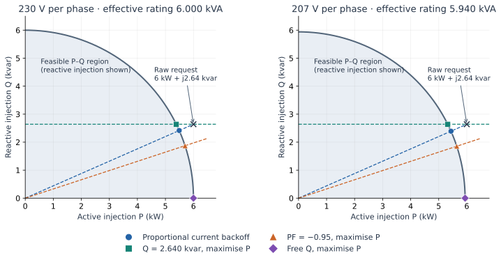
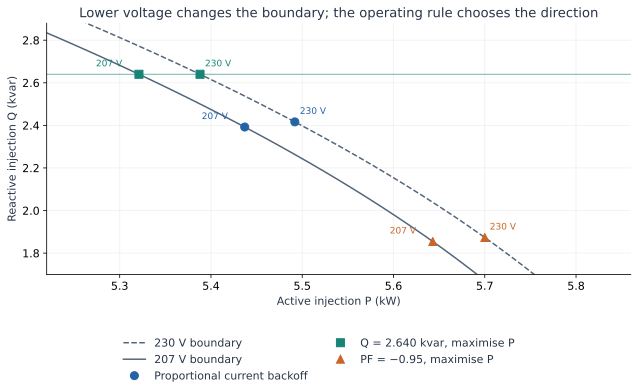

# From current limits to operating rules

For a step-by-step translation from sequential controller code, start with the
[controller-to-equilibrium workbook](controller_program_to_equilibrium.md).
Return here to apply that distinction to the inverter's P–Q capability region.

Why can two inverter models obey the same current limit and deliver different
watts and vars? Work through one balanced inverter, first at 230 V and then at
207 V per phase. By the end you should be able to distinguish three choices:

| Choice | Question it answers | Example |
|:--|:--|:--|
| Physical constraints | Which operating points can the hardware sustain? | Current and apparent-power limits |
| Operating relationship | Which points does this operating mode allow? | Fixed Q, fixed PF, or a proportional current command |
| Selection objective | Which allowed point should the optimiser choose? | Maximum active export |

The [reference comparison table](../components/inverter_operating_constraints.md#Simulation-and-optimisation-formulations)
catalogues the complete model. Start here for the geometry, then use the
[network reproductions](../ibr/formulation_reproductions.md) to see what changes
when voltage and current must be solved together.

## 1. Build the physical region

Take a lossless 6 kVA inverter with no filter voltage drop, a 6000 W DC source,
and a per-phase RMS current rating

```math
I_{max}=1.1\frac{6000}{3\times230}=9.5652\ \mathrm{A}.
```

Choose balanced positive-sequence voltage and current. Then total three-phase
complex power is ``S=P+jQ=3V I^*``, with positive P/Q meaning active/reactive
injection into the grid. The two hardware inequalities become

```math
P^2+Q^2\le6000^2,\qquad P^2+Q^2\le(3VI_{max})^2.
```

Their intersection is a disk of radius
``S_{effective}=\min(6000,3VI_{max})`` VA. The non-charging, lossless DC source
also restricts ``0\le P\le6000`` W. The figures show the part with Q≥0;
reactive absorption is the reflected part below the P axis.

At **230 V**, the effective radius is **6000 VA**: the apparent-power limit is
tighter. At **207 V**, it is **5940 VA**: the current limit is tighter. The
crossover is ``V=6000/(3I_{max})=209.09`` V. That number follows from these
ratings and assumptions; it is not a compliance threshold established here.

Balanced current is an explicit choice in this example. A three-leg bridge
requires the three converter currents to sum to zero; it can still carry
negative-sequence current. Under unbalance, filters or losses, this simple
P–Q disk does not describe the complete plant.

## 2. Choose a relationship and an objective

Hold the raw request at **6000 W + j2640 var** at both voltages. Holding Q fixed
isolates the allocation question; this is not a sweep of a regional volt-var
curve. The request is outside the feasible disk at both voltages.



The shaded region answers what is feasible. The coloured relationships and
points answer how operation is selected:

**Proportional current backoff.** Restrict every phase current to a common scale
of its raw command, ``I=tI_{raw}``, and maximise ``t`` with ``0\le t\le1``.
At this fixed voltage, ``(P,Q)=t(6000,2640)`` and

```math
t=\frac{S_{effective}}{\sqrt{6000^2+2640^2}}.
```

The point moves along the blue ray. Its Q/P ratio remains 0.44 because the
**common scaling relationship** imposes that ratio. A current inequality by
itself does not impose constant power factor. This example uses proportional
P/Q allocation as well as proportional current backoff; the forward controller
also has other P/Q priority options.

The [reference 207 V example](@ref inverter-saturation-comparison) uses var
priority at the apparent-power allocation stage before common current scaling,
giving approximately 5334 W / 2614 var. The proportional choices in this
tutorial give different numbers because that earlier allocation step differs.

**Strict Q with maximum export.** Impose ``Q=2640`` var, then maximise P. The
solution follows the horizontal green line to
``P=\sqrt{S_{effective}^2-2640^2}``. This is the interpretation of
`VoltVarWattConstraints` at a fixed Q target with an inactive watt ceiling.
It retains Q and curtails P. If the requested Q exceeds hardware capability,
the strict relationship is infeasible; it does not silently weaken Q tracking.

**Fixed PF with maximum export.** Choose `FixedPowerFactor(-.95)`. The negative
sign means reactive injection for positive P. The orange ray has a different
Q/P ratio: ``P=.95S_{effective}`` and
``Q=\sqrt{1-.95^2}S_{effective}``. Fixed PF is a declared operating relationship
and applies below the current limit too.

**Free Q with maximum export.** Add no Q relationship. In this particular
balanced lossless example, maximum P selects ``P=S_{effective},Q=0``. The
objective produces that result; “free Q” does not mean Q=0 in general. A voltage
constraint or a different objective can select nonzero Q.

## 3. Make the comparison executable

The shared script provides the fixed-voltage fixture and the four solves. It
also computes the closed-form values above independently of JuMP.

```@example pq_lesson
using PowerOptLab
include(joinpath(pkgdir(PowerOptLab), "scripts", "formulations", "ibr_reproductions.jl"))
choices = ibr_pq_tutorial()
for choice in choices
    @assert choice.result.solve.publishable
    @assert abs(choice.result.plant.p_poc-choice.expected_p_W) < .03
    @assert abs(choice.result.plant.q_poc-choice.expected_q_var) < .1
end
[(V=c.voltage, mode=c.mode, P_W=round(c.result.plant.p_poc;digits=2),
  Q_var=round(c.result.plant.q_poc;digits=2)) for c in choices]
```

For a quick numerical check at 207 V, proportional backoff gives approximately
5437 W / 2392 var, strict Q gives 5321 W / 2640 var, fixed PF gives
5643 W / 1855 var, and free Q gives 5940 W / 0 var. All four points reach the
same current boundary. Their different P/Q ratios demonstrate why the active
current bound does not determine the operating rule.

Here is how the three general dispatch modes are declared:

```@example pq_lesson
fixed_q = InverterOperatingConstraints(reactive=FixedReactivePower(2640.))
fixed_pf = InverterOperatingConstraints(reactive=FixedPowerFactor(-.95))
free_q = InverterOperatingConstraints()
plant = _repro_plant()  # 6 kVA, 9.5652 A; lossless fixed-voltage teaching fixture
device = ConstrainedInverter(plant, fixed_q;
    dc_source=DCSourceBounds(p_min=0.))
request = InverterControlRequest(p_available=6000.,p_rated=6000.,q_scale=6000.)
result = solve_constrained_inverter(_repro_grid(207.),device,request;
    objective=:max_export,solver_options=("tol"=>1e-9,))
@assert result.solve.publishable
@assert abs(result.plant.q_poc-2640.) < .03
(P_W=result.plant.p_poc,Q_var=result.plant.q_poc)
```

`FixedReactivePower(2640.)` and a constant 2640 var volt-var law give the same Q
equality in this fixture. Use `VoltVarWattConstraints` when Q should depend on
the solved sensing voltage. The default allocation is `:balanced_converter`;
the source declaration prevents charging. The grid fixture and plant helper
are example utilities in the script, rather than package APIs.



## 4. Check what your model actually promises

A **feasibility** solve at P=4000 W with free Q admits a range of reactive
outputs. At 207 V it allows
``|Q|\le\sqrt{5940^2-4000^2}``. It has no reason to select one Q within that
range until another relationship or objective does so. A successful feasibility
solve demonstrates a candidate operating point, not a dispatch law.

A **strict volt-var** solve promises the encoded Q equality. Missing Q curves
in `VoltVarWattConstraints` mean Q=0. Missing Q relationships in the general
`InverterOperatingConstraints` policy mean free Q. Inspect the chosen policy,
physical margins and curve residuals rather than inferring a policy from an
active current constraint.

A **forward-controller** solve promises its prescribed current equations,
including its chosen limiting sequence. Optimisation reproduces that controller
only when it includes the same operating restrictions. The proportional-ray
and sequence-priority examples make those additional restrictions explicit.

Finally, fixed voltage removes network feedback. In a feeder, changing P and Q
changes voltage, losses and the curve input. With an LCL filter, converter and
grid currents differ, so the location used to define a Q command matters too.
Continue with [matched and deliberately different network cases](../ibr/formulation_reproductions.md#Unbalanced-feeders-and-LCL-current-targets).
The [complete formulation table](../components/inverter_operating_constraints.md#Simulation-and-optimisation-formulations)
then provides a reference for the remaining plant features and planned variants.
