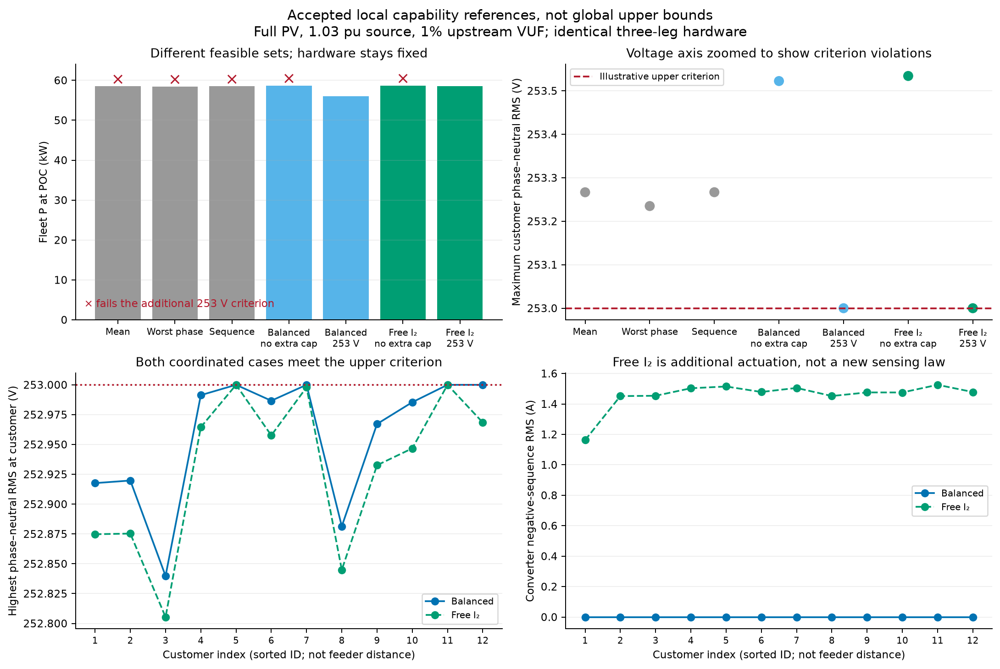

# Generated coordinated OPF comparison

> **Historical campaign.** These results describe a pinned earlier model revision. See the [current benchmark](engineering_benchmark.md) and [evidence/replay index](evidence/README.md).

Executed benchmark source revision: `ffbec9999270ea082a418bec265bb62acf4b9a97`.

All 24 predeclared cases pass the independent physical/policy, native SI equation, additional customer-voltage and fixed-PQ replay gates. Saved phasors are independently re-audited. These are feasible local nonconvex results, not global upper bounds.

## Full PV, 1.03 pu source, 1% aligned upstream VUF

Hardware is identical. The 253 V upper phase-to-neutral limit is an illustrative additional planning criterion. Autonomous VV+VW uses reactive priority; the benchmarks release those Q laws. Free I₂ additionally releases sequence allocation.

| Operation | Fleet P (kW) | Fleet Q (kvar) | Maximum customer phase (V) | Meets 253 V criterion? |
| --- | ---: | ---: | ---: | --- |
| Mean VV+VW | 58.5064 | -28.0534 | 253.2667 | No |
| Worst-phase VV+VW | 58.4575 | -31.4238 | 253.2350 | No |
| Sequence VV+VW | 58.5066 | -28.0363 | 253.2668 | No |
| Coordinated balanced; No extra cap | 58.7014 | 0.0727 | 253.5225 | No |
| Coordinated balanced; 253 V cap | 55.9572 | -44.1761 | 253.0000 | Yes |
| Coordinated free I₂; No extra cap | 58.7015 | 0.0726 | 253.5342 | No |
| Coordinated free I₂; 253 V cap | 58.5455 | -18.3999 | 253.0000 | Yes |

An autonomous point above 253 V cannot serve as a feasible export comparator under that added criterion. The balanced-current reference isolates coordination/free-Q capability; the free-I₂ reference includes extra actuation. The latter is research capability and does not establish regional permission for deliberate unbalanced injection.

## Active-power accounting at the 253 V criterion

| Allocation | Available DC (kW) | Unused DC (kW) | Converter/capacitor/filter loss (kW) | POC P (kW) |
| --- | ---: | ---: | ---: | ---: |
| Balanced | 60.0000 | 2.3198 | 1.7230 | 55.9572 |
| Free I₂ | 60.0000 | 0.0000 | 1.4545 | 58.5455 |

DC-link availability excludes upstream source/DC–DC losses. All cases are energized; these snapshots are not chronological energy or EMT results.

A standalone SVG accompanies the PNG. See [setup, reproduction and limitations](coordinated.md).
