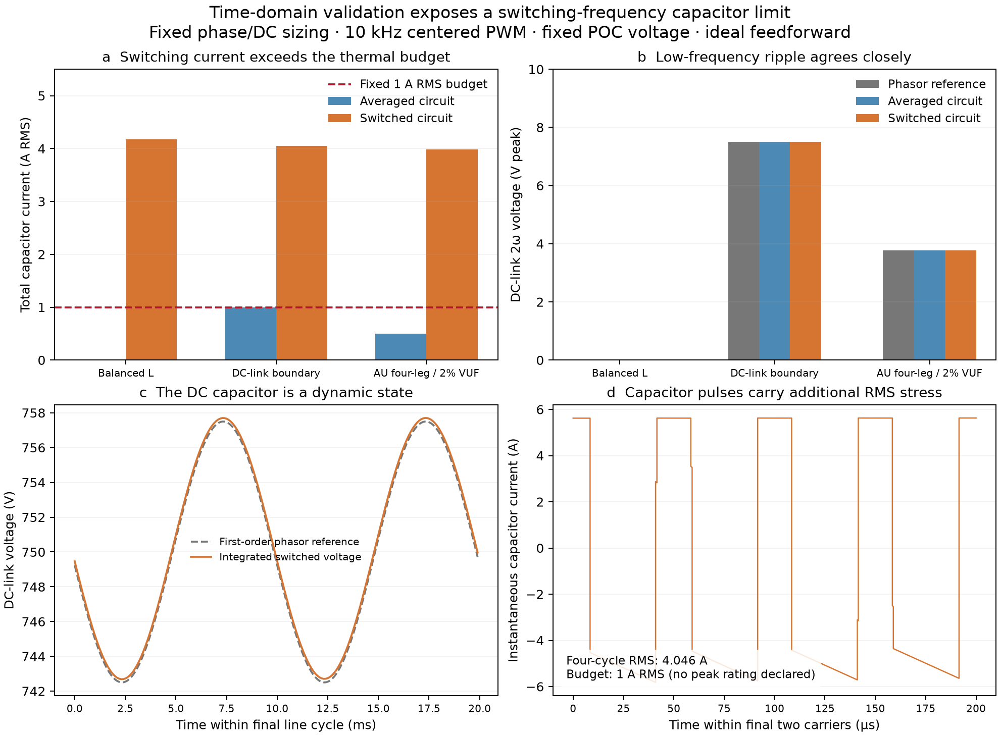

# Representative switched-circuit validation

All three representative cases pass the predeclared mechanism and time-step convergence bands. All three switched cases fail the unchanged 1 A capacitor RMS budget. Agreement with a fundamental-frequency model therefore does not certify switching thermal feasibility.

| Case | Maximum fundamental-current error (A RMS) | 2ω voltage phasor error (V peak) | Averaged capacitor (A RMS) | Switched capacitor (A RMS) |
|---|---:|---:|---:|---:|
| balanced_L | 0.00450 | 0.00490 | 0.00000 | 4.17067 |
| binding_dc_capacitor | 0.00499 | 0.00491 | 0.99967 | 4.04630 |
| four_leg_unbalanced | 0.00702 | 0.00937 | 0.50168 | 3.98539 |

The independent Python record audit passes 310 coverage, source, waveform, energy, spectral, mesh and engineering-flag checks. The Julia cross-check maps the measured non-2ω RMS stress to the existing `i_sw` bound: all three configurations are rejected because that reserve alone exceeds the 1 A budget. This point-specific measurement is not a conservative reserve over other dispatches.

The synthetic DC-link boundary also exceeds the 7.5 V peak 2ω limit by 0.0000938 V in the averaged nonlinear capacitor integration with its mean DC voltage matched to 750 V. That first-order boundary approximation is retained as a failed engineering check; its tolerance is not enlarged. Practical boundary certification needs a model-error allowance or a nonlinear energy-based bound.

The circuit integrates all phase currents, the physical neutral return and DC-capacitor voltage. Switch edges are exact integration boundaries; RK4 substeps and statistical quadrature are refined at 32/64/128 steps per carrier. The Fourier/RMS window is the final four line cycles after six cycles discarded. Energy accounting includes filter magnetic energy, capacitor energy and the declared mean converter loss.

The input is a constant-power source at the regulated DC-link boundary, with no 2ω input power; source current may ripple. This does not validate the optional small-signal R–L source model. Converter loss is a fixed lumped mean from the accepted fundamental operating point. The centered PWM uses sampled sinusoidal feedforward and DC compensation; no PLL, current-feedback, service-controller or feeder dynamics are simulated. Finite-window DC drift is retained, so periodic steady state is not claimed. LCL/split-link dynamics, dead time, semiconductor switching losses, ESR heating, protection and stability remain outside this representative matrix.

These results support using a dispatch-dependent PWM stress model or a certified conservative reserve during allocation before making switching-thermal claims. Increasing the capacitor rating is not used to make these points pass. See [method, source assumptions and reproduction](emt.md).

