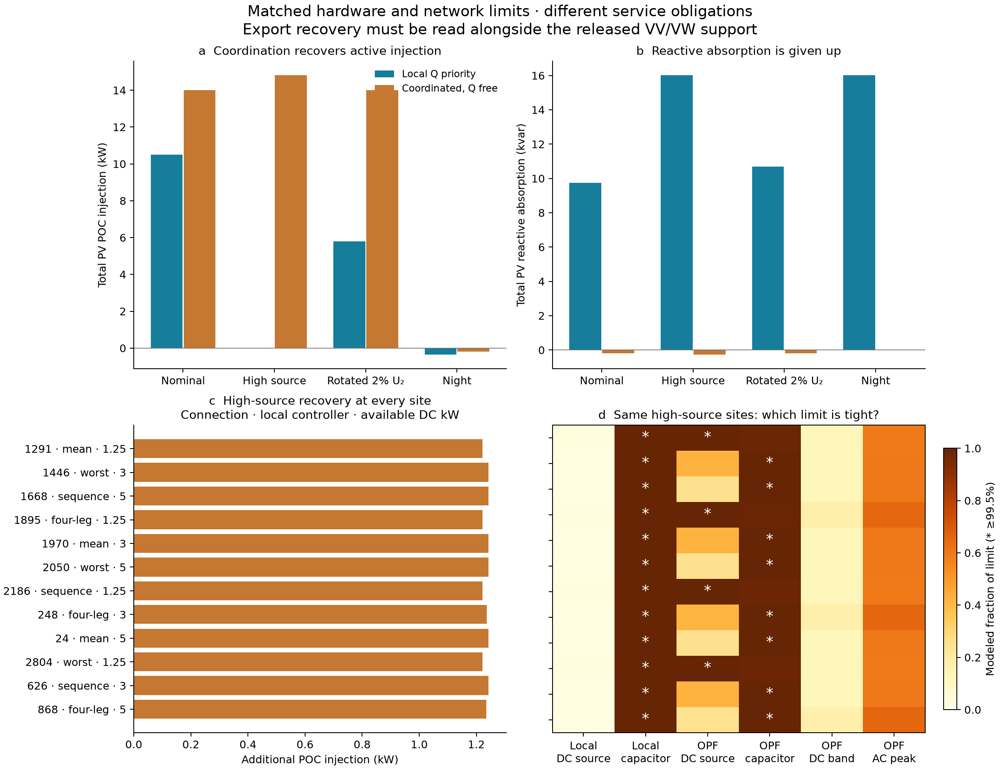
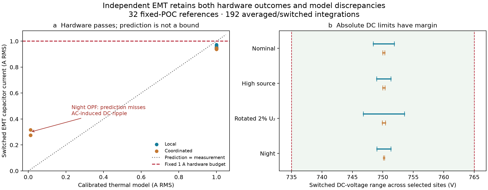

# Matched mixed-controller PF versus coordinated OPF

The same 12 sites, physical hardware, PV availability, loads, source conditions, PWM/energy models and network ceilings are used in both modes. Local mean, worst-phase, sequence and four-leg controllers operate together with reactive priority. The coordinated objective maximizes total POC active injection with Q free and the original VV/VW commands released. This is a comparison of service choices under matched physical capability; it is not an equal-reactive-service dominance result or a global nonconvex bound.

The common 735–765 V DC band and 14 A phase/neutral peak ceilings are declared study operating assumptions. No manufacturer peak rating is inferred from the unchanged 10 A RMS rating.



Positive P/Q mean injection; negative values mean import/absorption. Available DC is 37 kW in each daytime case and zero at night. The 253 V planning ceiling is checked at all 55 LV buses, alongside native conductor/transformer limits. It is an illustrative study criterion, not a regional conformity claim.

| Condition | Local P (kW) | OPF P (kW) | Recovery (kW) | Local Q (kvar) | OPF Q (kvar) | Local curtailed DC (kW) | OPF curtailed DC (kW) |
|---|---:|---:|---:|---:|---:|---:|---:|
| Nominal | 10.496 | 14.013 | 3.517 | -9.740 | 0.192 | 26.157 | 22.652 |
| High source | -0.001 | 14.815 | 14.816 | -16.018 | 0.277 | 36.641 | 21.846 |
| Rotated 2% U₂ | 5.789 | 14.007 | 8.218 | -10.700 | 0.191 | 30.864 | 22.659 |
| Night | -0.360 | -0.181 | 0.179 | -16.013 | 0.000 | 0.000 | 0.000 |

In the high-source case, the local reactive-priority allocations use almost all their capacitor thermal budget for reactive support. Releasing those commands permits active injection. Higher-availability sites then reach the capacitor budget, while low-availability sites reach their DC source ceiling. DC-voltage and AC peak bounds retain margin. Panel d normalizes DC excursions by the 15 V headroom around 750 V; its stars mark near-limit utilization, not a dual sensitivity certificate.

These cases are inverter-limited: the largest native conductor utilization is 9.35%, and the largest LV phase-neutral voltage is 252.669 V. The comparison therefore does not establish a coordination benefit under active feeder congestion.

The [complete per-site CSV](results/engineering_benchmark/devices.csv) includes requested and achieved Q, reactive-service error, DC curtailment, converter/filter losses and named binding limits. Night recovery is reduced loss import, with no PV curtailment.



All **32 representative references and 192 integrations** pass the declared averaged/switched mechanism, mesh and hardware checks. The largest switched capacitor RMS is **0.972793 A** against the unchanged 1 A budget. The parent/circuit audit passes 391 selection/availability checks and 7274 circuit-record checks.

**A retained thermal-prediction failure:** the four coordinated night references predict approximately 0.012 A capacitor RMS, while switched EMT measures 0.276–0.316 A. The frozen-fundamental-current predictor omits the contribution generated by AC switching ripple. Its 10% calibrated allowance does not make it a conservative bound in this low-current regime. Those points pass the fixed 1 A hardware budget; their prediction failures remain explicit in `matched_audit.json`. The analytical AC-current and combined DC-voltage envelopes are separate from this calibrated thermal estimate.

EMT holds each selected POC phasor boundary fixed, uses constant-power DC input and fixed mean converter loss, and includes finite-window DC drift. It does not simulate PLL/current/service-controller or feeder dynamics, establish periodic steady state, or certify all-time voltage excursions. The independent SI feeder audit reconstructs fundamental-frequency currents; carrier harmonics are not propagated through feeder ampacity constraints. The carrier approximation and its declared P/Q/sequence/modulation domain are documented in the [domain validation](engineering_domain.md); the retained LF-only DC-voltage failure is in the [boundary experiment](engineering_boundary.md).

The solver initializes four-leg neutral channels at zero, then sequentially removes those temporary rows and retains accepted primal/dual starts. The final solve has full matched capability and the pure export objective. A separate [initialization ablation](results/engineering_benchmark_numerical_control/status.json) retains an `ITERATION_LIMIT` outcome under the same final constraints; successful SI feeder checks do not promote it.

Saved-point audits pass 372 record conditions, 3672 SI inverter checks and 6608 independent SI network checks. The campaign retains every raw allocation/OPF stage and point/source fingerprints. The authoritative PF/OPF inputs were generated from clean committed source; sizing is unchanged.

Reproduce into new output paths:

```sh
julia --project=. scripts/australian_pv/run_engineering_benchmark.jl /tmp/engineering_benchmark python3
julia --project=. scripts/australian_pv/audit_engineering_benchmark.jl /tmp/engineering_benchmark python3
julia --project=. scripts/australian_pv/prepare_engineering_benchmark_emt.jl /tmp/engineering_benchmark /tmp/engineering_emt_inputs.json
julia --project=. scripts/australian_pv/emt_circuit.jl /tmp/engineering_emt_inputs.json /tmp/engineering_emt
python3 scripts/australian_pv/audit_engineering_benchmark_emt.py /tmp/engineering_emt_inputs.json /tmp/engineering_emt /tmp/engineering_benchmark
python3 scripts/australian_pv/plot_engineering_benchmark.py
```

The plotting command checks the committed CSVs against saved-point evidence and reruns the independent matched EMT audit before publication. Python requires NumPy and Matplotlib. Generated figures and this report use committed inputs; new runs retain their own fingerprints.
