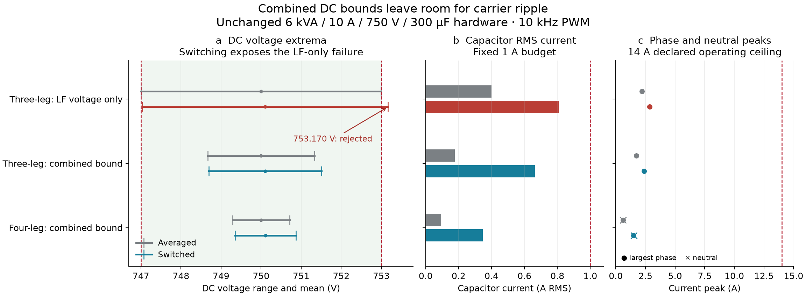

# Combined switching and nonlinear DC-voltage boundary

This boundary experiment compares the existing LF-only voltage guard with the combined LF/carrier guard, and exercises the four-leg implementation. It is separate from the matched feeder PF/OPF benchmark. All three retain 6 kVA, 10 A phase RMS, 750 V, 300 µF and the 1 A capacitor RMS budget. The shared 747–753 V validation band and 14 A peak ceilings are declared operating assumptions, not inferred manufacturer ratings.



The grey rows show averaged integration; blue rows show switched integration. Red identifies the reference that fails the upper DC-voltage check. The voltage segments span measured minimum to maximum, with a dot at the measured mean. All three meshes (32, 64 and 128 steps/carrier) remain in the saved record; the figure uses the finest mesh.

| Reference | P at POC (W) | Q at POC (var) | I₂ (A RMS) | Switched DC range (V) | Capacitor RMS (A) | Outcome |
|---|---:|---:|---:|---:|---:|---|
| Three-leg: LF voltage only | 600.000 | -300.000 | 0.616475 | 747.032667–753.170120 | 0.810511 | Fail: DC upper voltage |
| Three-leg: combined bound | 600.000 | -300.000 | 0.274269 | 748.697633–751.504819 | 0.662812 | Pass |
| Four-leg: combined bound | 0.073 | -101.151 | 0.146595 | 749.354610–750.869469 | 0.346332 | Pass |

The three-leg references request the same 600 W active power, −300 var reactive power and 1 A negative-sequence current. Q and P have priority; the combined guard reduces the remaining sequence service to leave voltage headroom. The four-leg reference has a different declared request (600 W total and per-phase Q of [−600, 0, 0] var); its row demonstrates that topology and is not a matched controller performance comparison.

The independent record audit passes **747 checks** covering provenance, mechanism agreement, energy, mesh convergence, extrema witnesses and engineering flags. The LF-only switched reference fails only the upper DC-voltage check; its failure remains in the results and is not accepted as hardware-feasible.

These are fixed-POC, feedforward L-filter circuits with a constant-power DC input and fixed mean converter loss. Finite-window DC mean drift is retained: the switched extrema include both carrier ripple and that drift. This experiment does not isolate a carrier-only error or establish periodic steady state, closed-loop regulation, feeder dynamics, LCL validity or all-time transient bounds. Analytical carrier bounds and the calibrated 10% capacitor thermal allowance remain distinct.

Reproduce from the repository root:

```sh
julia --project=. scripts/australian_pv/prepare_engineering_boundary_emt.jl /tmp/boundary_inputs.json
julia --project=. scripts/australian_pv/emt_circuit.jl /tmp/boundary_inputs.json /tmp/boundary_emt
python3 scripts/australian_pv/audit_emt.py /tmp/boundary_inputs.json /tmp/boundary_emt
python3 scripts/australian_pv/plot_engineering_boundary.py
```

The plotting command reaudits the committed records before regenerating the figure, table and report. New simulations retain their own input/source hashes and are not relabeled as the committed campaign.
