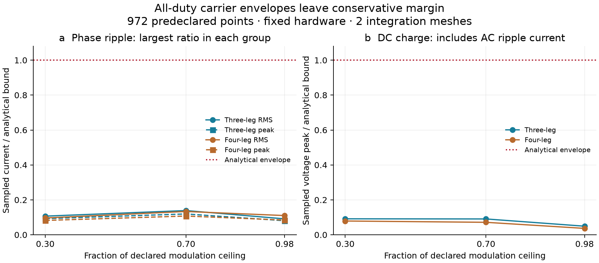

# Declared switching-envelope validation domain

The independent NumPy oracle passes **36,031 checks over 972 operating points**. The domain is declared in the preparation script and independently checked by the oracle; publication cannot shrink it to accepted points.

| Dimension | Declared values |
|---|---|
| Topology | Three-leg; four-leg with explicit neutral |
| Total converter P | 0, 600, 5000 W |
| Total converter Q | −2000, 0, +2000 var |
| Negative-sequence current | 0, 1 A RMS |
| Negative-sequence voltage | 2% of positive sequence |
| Sequence angle | 0°, 120°, 240° |
| Fraction of 0.96 modulation ceiling | 0.30, 0.70, 0.98 |
| Carrier/line angle | 0°, 60°, 120° |
| Four-leg zero-sequence current | 0.1 A RMS |
| Independent meshes | 8192, 16384 samples per carrier |



The figure shows the largest ratio over P/Q, sequence and carrier-angle variations in each topology/modulation group. A ratio below one means the sampled waveform stays within its analytical carrier envelope; it does not measure total inverter utilization. The frozen bus is 750 V; AC reserves use the declared 765 V upper bound. Bounds retain their original all-duty derivation and are not fitted to this sweep.

The largest exact-event versus sampled phase-RMS difference is 0.000222 A; the largest frozen-current DC-extremum difference is 0.000150 V. Across meshes, the largest RMS difference is 0.000554 A and the largest coupled-charge peak difference is 0.000251 V. The independent passive R/L orbit checks also enforce periodic closure and phase/neutral RMS and peak envelopes.

**831 points violate at least one physical engineering limit and are retained with their failure names.** These include intentionally stressed power/current combinations. Carrier-domain agreement does not turn them into acceptable dispatches. The engineering-feasibility labels are Julia SI-model diagnostics; the independent oracle validates carrier mechanisms, bounds, coverage and retention, not all those feasibility labels.

The hardware remains 6 kVA, 10 A, 750 V, 300 µF, a 1 A capacitor budget and the same filter. This is a frozen-bus/frozen-reference, inductive carrier approximation with periodic mean-subtracted charge. It does not establish coupled nonlinear transient bounds, cumulative DC-energy drift, LCL validity or closed-loop stability. The calibrated 10% capacitor thermal allowance is separate and is not validated or retuned by this carrier sweep. Representative averaged/switched EMT is documented in the [boundary experiment](engineering_boundary.md); mixed-feeder OPF/EMT validation remains a separate deliverable.

Reproduce from the repository root:

```sh
julia --project=. scripts/australian_pv/prepare_engineering_domain.jl /tmp/domain_inputs.json
python3 scripts/australian_pv/audit_engineering_domain.py /tmp/domain_inputs.json /tmp/domain_audit.json
python3 scripts/australian_pv/test_engineering_domain.py
python3 scripts/australian_pv/plot_engineering_domain.py
```

The tests and plot use committed inputs; the plot reruns the complete independent audit. Eight tests cover full-domain acceptance and corrupted coverage, bounds, currents, gates, sources and failure flags.
