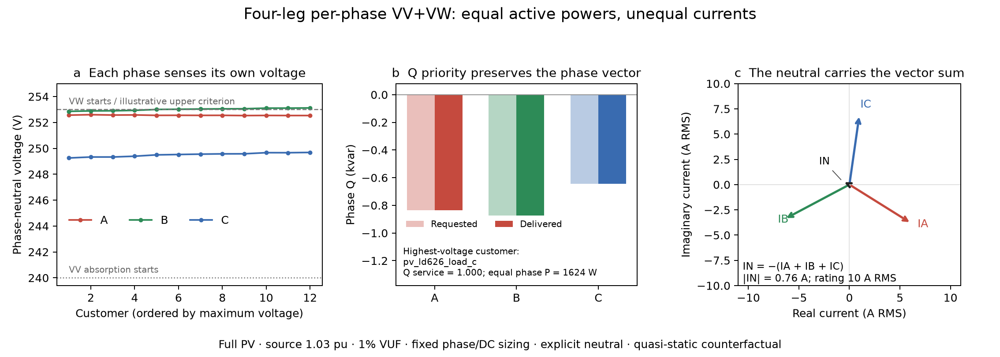

# Australian four-leg research-control results

> **Historical campaign.** These results describe a pinned earlier model revision. See the [current benchmark](engineering_benchmark.md) and [evidence/replay index](evidence/README.md).

Generated from eleven accepted saved-point audits. This is an explicit four-wire topology and policy counterfactual; phase and DC sizing are unchanged. Neutral rating is 10 A RMS and neutral filter R/X equals the phase arm. These assumptions do not establish Australian connection conformity or dynamic stability.

| Case | POC P (kW) | POC Q (kvar) | Maximum PN voltage (V) | Maximum neutral (A RMS) |
|---|---:|---:|---:|---:|
| matched_s1_p1 | -0.290 | -8.510 | 244.939 | 0.867 |
| matched_s1_p2 | 29.347 | -9.643 | 245.369 | 0.874 |
| matched_s1_p3 | 58.593 | -10.757 | 245.940 | 0.893 |
| matched_s2_p1 | -0.537 | -25.864 | 252.245 | 0.816 |
| matched_s2_p2 | 29.179 | -26.968 | 252.570 | 0.823 |
| matched_s2_p3 | 58.482 | -28.053 | 253.121 | 0.842 |
| vuf0 | 58.503 | -28.034 | 252.072 | 0.210 |
| vuf2 | 58.439 | -28.102 | 254.245 | 1.761 |
| balanced_loads | 58.477 | -28.008 | 253.191 | 0.943 |
| disconnected_s1 | 0.000 | 0.000 | 245.040 | 0.000 |
| disconnected_s2 | 0.000 | 0.000 | 252.396 | 0.000 |

The full-PV, 1.03 pu, 1% VUF point exports 58.482 kW with maximum PN voltage 253.121 V. All phase Q requests are delivered, while a shared source couples active dispatch. The maximum voltage still exceeds the illustrative 253 V planning criterion: per-phase VV is not a voltage-constrained OPF or a guarantee of compliance.

The independent saved-phasor audit recomputes 3,348 hardware/policy checks for 108 energized inverter records. Fixed-PQ replay checks network injection consistency in the same engine; it is not an external circuit or EMT validation.

