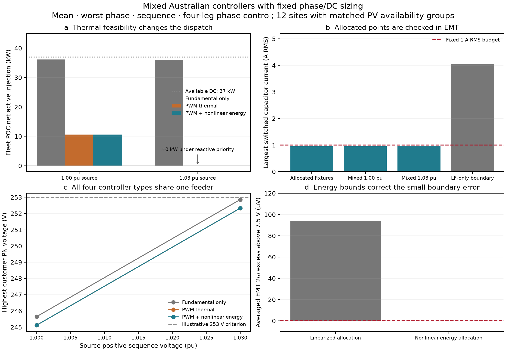

# Mixed-controller PWM and nonlinear-energy results

> **Historical campaign.** These results describe a pinned earlier model revision. See the [current benchmark](engineering_benchmark.md) and [evidence/replay index](evidence/README.md).

All eight predeclared coupled cases are accepted. Each feeder contains mean, worst-phase, sequence and four-leg controllers simultaneously. Phase/DC sizing is unchanged. Each controller group receives the same 25/60/100% availability pattern; locations differ, so these mixed cases do not establish a causal ranking of controller laws.

| Case | POC net P (kW) | POC Q (kvar) | Maximum PN voltage (V) | Maximum capacitor model (A RMS) |
|---|---:|---:|---:|---:|
| fundamental_s1 | 36.149 | -10.699 | 245.647 | 0.215944 |
| fundamental_s2 | 35.982 | -28.028 | 252.862 | 0.233378 |
| pwm_s1 | 10.640 | -9.746 | 245.120 | 1.000000 |
| pwm_s2 | -0.001 | -16.040 | 252.332 | 1.000000 |
| energy_s1 | 10.640 | -9.746 | 245.120 | 1.000000 |
| energy_s2 | -0.001 | -16.040 | 252.332 | 1.000000 |
| energy_night | -0.360 | -16.035 | 252.328 | 1.000000 |
| energy_mixed_disconnection | -0.001 | -10.693 | 252.357 | 1.000000 |

Saved-point reconstruction passes 549 conditions and 2220 SI physical checks, plus same-engine fixed-PQ replay. The EMT matrix covers all 24 energized inverter points from both nonlinear-energy daytime mixed cases and four fixed-boundary references, at three meshes in averaged and switched modes. All 27 PWM-allocated references meet the declared switched engineering checks; their largest capacitor RMS is 0.965688 A. The separate LF-only boundary is retained as a switching-thermal negative control.

At the matched ripple boundary, averaged time-domain 2ω voltage is 7.500093753 V for linearized allocation and 7.499999997 V for nonlinear-energy allocation. The specified 750 V mean is preserved. The nonlinear correction is small here; the large dispatch change is caused by enforcing the previously omitted PWM thermal component.

The initial 5% allowance passed four balanced probes but exceeded 1 A at three four-leg mixed points (up to 1.0059 A). Those earlier points remain explicit negative controls. The default model allowance is now 10%, with sizing unchanged; it is not a universal bound on AC ripple or device dynamics. An averaged three-wire common-mode projection error exposed by the mixed cases was corrected and receives an independent KCL/energy regression.

The mixed night case retains reactive service and imports loss power at zero PV. Partial disconnection removes four complete AC models. No 253 V constraint is imposed by these local policies; the plotted criterion is illustrative. EMT uses fixed POC voltages, ideal centered PWM, constant DC input power and fixed mean converter loss; feeder/service dynamics, LCL/split-link dynamics and semiconductor losses remain outside this validation.

See [setup and reproduction](thermal_energy.md).
