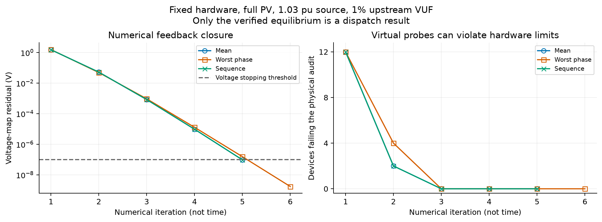
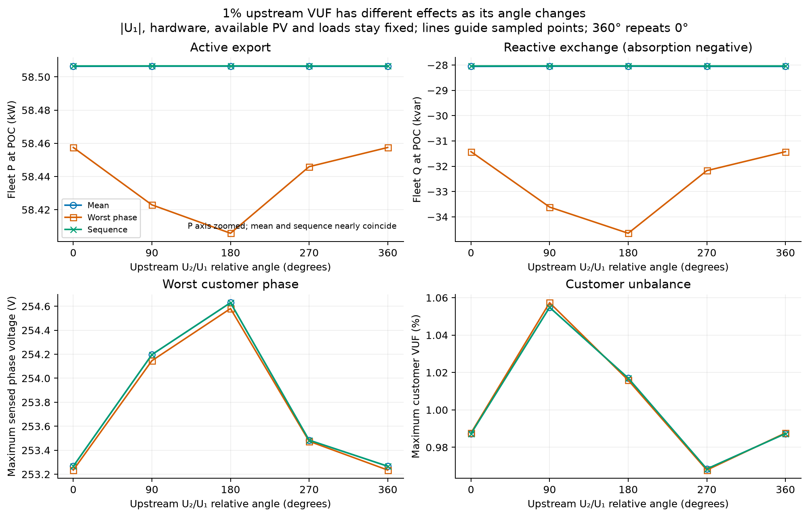
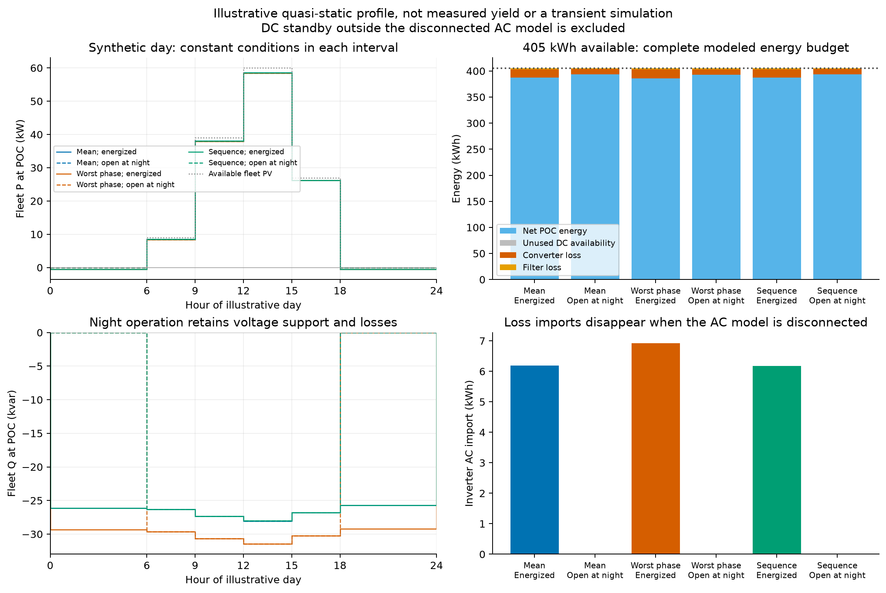

# Generated voltage-aware study results

> **Historical campaign.** These results describe a pinned earlier model revision. See the [current benchmark](engineering_benchmark.md) and [evidence/replay index](evidence/README.md).

Generated by `scripts/australian_pv/plot_voltage_aware.py` from the saved CSV/JSON records.

Executed source revision: `ffbec9999270ea082a418bec265bb62acf4b9a97`. All 41 snapshots and 36 chronological intervals are accepted. The snapshot record audit verifies 58 executed source/setup hashes. These are model checks, not hardware certification, regional conformity or EMT validation.

## Matched full-PV equilibrium

1.03 pu positive-sequence source, 1% aligned upstream VUF, fixed hardware and common reactive-priority terminal settings. Sequence denotes positive-sequence **sensing**; none of these laws requests negative-sequence cancellation.

| Controller | Fleet P at POC (kW) | Fleet Q at POC (kvar) | Maximum sensed phase (V) | Maximum customer VUF (%) | Iterations |
| --- | ---: | ---: | ---: | ---: | ---: |
| Mean | 58.5064 | -28.0534 | 253.2667 | 0.9873 | 5 |
| Worst phase | 58.4575 | -31.4238 | 253.2350 | 0.9877 | 6 |
| Sequence | 58.5066 | -28.0363 | 253.2668 | 0.9873 | 5 |

At the same 1% upstream VUF, changing its relative angle changes worst-phase fleet P from 58.4058 to 58.4575 kW, and Q from -34.6485 to -31.4238 kvar. Magnitude-only unbalance studies miss that dependence. The P difference is small relative to fleet output; the figure explicitly zooms that axis.

## Synthetic 24-hour profile

All profiles have 405 kWh of available fleet PV. Export/import are integrated per inverter before aggregation; Q is signed exchange (absorption negative). These are inverter POC quantities, excluding feeder losses and customer-load energy.

| Controller | Night AC mode | Net POC energy (kWh) | AC import (kWh) | Converter + filter loss (kWh) | Q exchange (kvarh) |
| --- | --- | ---: | ---: | ---: | ---: |
| Mean | Energized | 387.5470 | 6.1842 | 17.4530 | -636.8896 |
| Mean | Disconnected | 393.7312 | 0.0000 | 11.2688 | -325.6511 |
| Worst phase | Energized | 386.1542 | 6.9260 | 18.8458 | -717.1592 |
| Worst phase | Disconnected | 393.0802 | 0.0000 | 11.9198 | -365.8819 |
| Sequence | Energized | 387.5539 | 6.1805 | 17.4461 | -636.4752 |
| Sequence | Disconnected | 393.7343 | 0.0000 | 11.2657 | -325.4452 |

The largest absolute integrated unused-DC term is 4.07e-08 kWh (a numerical residual within the physical acceptance tolerance). This profile therefore shows loss costs rather than material DC curtailment. Energized night control retains Q exchange and imports loss power. Opening the AC contactor removes both modeled services and AC losses; the disconnected DC standby consumption is undefined and excluded, so this is not a total-product energy-saving claim.

Maximum fixed-PQ replay phasor difference across all 77 cases: 6.51e-08 V. Maximum absolute energy-identity residual: 1.18e-10 Wh. The replay uses the same network engine with a different injection formulation.

## Figures

SVG versions accompany each PNG. See [setup and limitations](voltage_aware.md).
